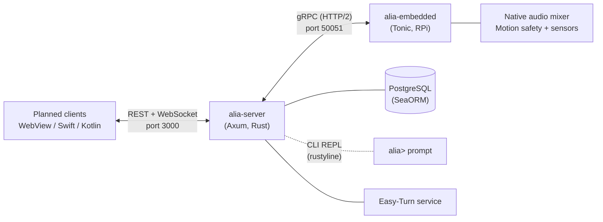

# Project Alia

A personal AI assistant system with voice interaction, smart home control, and an extensible plugin architecture. The server owns reasoning and continuous turn detection; the Raspberry Pi node owns continuous capture, scoped mixed playback and hardware safety. They can run on separate hosts or on one machine. The previous frontend has been removed. Three replacement clients are planned; none is implemented yet.



## Packages

| Package | Description |
|---------|-------------|
| [alia-server](packages/alia-server/) | Central server — API, AI pipeline, WebSocket, channel adapters, module orchestration |
| [alia-embedded](packages/alia-embedded/) | Raspberry Pi edge node — capture/VAD, wake cues, native mixer, Motion safety, sensors, gRPC |

### Shared Crates

| Crate | Description |
|-------|-------------|
| [proto](crates/proto/) | Shared Protobuf definitions and generated code |
| [alia-core](crates/alia-core/) | Shared identity, delivery, output-control and Motion contracts |
| [transport](crates/transport/) | Shared transport/auth helpers for server and embedded communication |

## Prerequisites

- [mise](https://mise.jdx.dev/) (manages Node, pnpm, Rust versions automatically)
- Docker (for PostgreSQL)
- `protoc` (Protocol Buffers compiler)

Rust is pinned to 1.96.0 in `mise.toml` and `rust-toolchain.toml`. Software verification also builds the Rust PDK example for `wasm32-unknown-unknown`; install that target with `rustup target add wasm32-unknown-unknown --toolchain 1.96.0` when using a standalone toolchain.

## Quick Start

```bash
# 1. Install tool versions via mise
mise install

# 2. Start PostgreSQL
docker compose up -d

# 3. Copy and edit config files
cp config/server.example.toml config/server.toml
cp -R config/server.example.d config/server.d
cp config/embedded.example.toml config/embedded.toml
# Choose providers in config/server.toml [modules], then tune provider settings
# in config/server.d/providers/ and voice settings in config/server.d/profiles/.

# 4. Run the server
cargo run -p alia-server

# 5. Run the embedded node (on Raspberry Pi or locally for dev)
cargo run -p alia-embedded
```

Or use the convenience scripts:

```bash
# Install development script dependencies
pnpm install

# Run DB + server + embedded
pnpm dev
# pnpm dev:backend is the same entry point
```

## Mise Tasks

```bash
mise run dev-server     # cargo run -p alia-server
mise run check          # cargo check --workspace
bash scripts/verify-software.sh test  # isolated PostgreSQL + WASM fixtures + full software regression
mise run db             # docker compose up -d postgres
```

## Project Structure

```
project-alia/
├── config/                   # Configuration files (gitignored, examples tracked)
│   ├── server.example.toml
│   └── embedded.example.toml
├── crates/
│   ├── proto/                # Shared Protobuf definitions
│   └── transport/            # Shared transport/auth helpers
├── packages/
│   ├── alia-server/          # Server (Rust / Axum)
│   └── alia-embedded/        # Edge node (Rust / Tonic)
├── docs/                     # Architecture & design documents
├── Cargo.toml                # Rust workspace root
├── package.json              # Development convenience scripts
├── mise.toml                 # Tool versions & dev tasks
└── docker-compose.yml        # PostgreSQL
```

## Tech Stack

- **Server**: Rust, Axum, SeaORM, tokio, utoipa, rustyline
- **Embedded**: Rust, Tonic (gRPC), tokio::process
- **Frontend**: Removed; replacement clients are planned below.
- **Communication**: REST + WebSocket (frontend ↔ server), gRPC (server ↔ embedded), CLI REPL (local dev)
- **Database**: PostgreSQL 17
- **Tooling**: mise, pnpm, Docker

## Planned Frontends

This stage only removes the previous frontend. No replacement packages or dependencies are installed.

- **WebView**: React + Next.js + coss-ui + Tailwind CSS + SWR + Hey API + [Tayori](https://tayori.skk.moe), with [eslint-config-sukka](https://github.com/SukkaW/eslint-config-sukka).
- **iOS 27+**: Fully native Swift, using Apple's current official UI and platform stack when implementation begins.
- **Android 17**: Fully native Kotlin, using Google's current official UI and platform stack with Material 3 Expressive (MD3E).

The server retains REST, WebSocket and API documentation endpoints. It no longer serves frontend static files or reads `ALIA_FRONTEND_DIST`; the website root has no UI until a replacement is built.

## Documentation

Start with [docs/README.md](docs/README.md) for the current architecture,
configuration, voice pipeline, protocol, and operations documentation. Older
long-form notes live under `docs/legacy/` and are kept only as historical
references.

## Feature Flags (alia-server)

The server uses Cargo feature flags for conditional compilation. The default set below enables the current server providers and channel. Features select compiled capabilities; configuration selects runtime providers.

| Feature | Description |
|---------|-------------|
| `channel-embedded` | gRPC channel adapter for communicating with alia-embedded |
| `llm-openai` | OpenAI GPT backend |
| `llm-anthropic` | Anthropic Messages backend |
| `llm-gemini` | Google Gemini backend |
| `stt-whisper` | Whisper speech-to-text |
| `tts-sovits` | SoVITS text-to-speech |
| `embed-openai` | OpenAI embedding backend |
| `tools-http` | Built-in HTTP/fetch tool support |
| `insights` | Scheduled insights system |
| `turn-easy` | Server-side Easy-Turn HTTP adapter |
| `plugin-home-assistant` | Home Assistant tool plugin |

Build without the default feature set:

```bash
cargo build -p alia-server --no-default-features
```

Build with only specific features:

```bash
cargo build -p alia-server --no-default-features --features "llm-openai,stt-whisper"
```

Embedded's default `sherpa-onnx` feature supplies Sherpa KWS and the ONNX Runtime
used by the Rust `silero` VAD; `vision-opencv` is optional.
Its native mixer and scoped output contracts are always compiled.

## License

[MIT](LICENSE)
