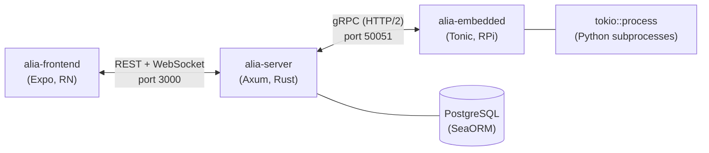

# Project Alia

A personal AI assistant system with voice interaction, smart home control, and an extensible plugin architecture. Runs as a split-brain setup: a server (upper machine) handles AI orchestration, and a Raspberry Pi edge node (lower machine) manages hardware I/O.



## Packages

| Package | Description |
|---------|-------------|
| [alia-server](packages/alia-server/) | Central server — API, AI pipeline, WebSocket, module orchestration |
| [alia-embedded](packages/alia-embedded/) | Raspberry Pi edge node — wake-word, process management, plugin sandbox, gRPC |
| [alia-frontend](packages/alia-frontend/) | Cross-platform consumer app (React Native / Expo) |

### Shared Crates

| Crate | Description |
|-------|-------------|
| [proto](crates/proto/) | Shared Protobuf definitions and generated code |
| [transport](crates/transport/) | USB/WiFi transport layer abstraction |

## Prerequisites

- [mise](https://mise.jdx.dev/) (manages Node, pnpm, Rust versions automatically)
- Docker (for PostgreSQL)
- `protoc` (Protocol Buffers compiler)

## Quick Start

```bash
# 1. Install tool versions via mise
mise install

# 2. Start PostgreSQL
docker compose up -d

# 3. Copy and edit config files
cp config/server.example.toml config/server.toml
cp config/embedded.example.toml config/embedded.toml

# 4. Run the server
cargo run -p alia-server

# 5. Run the embedded node (on Raspberry Pi or locally for dev)
cargo run -p alia-embedded

# 6. Run the frontend
cd packages/alia-frontend && pnpm install && pnpm dev
```

Or use the convenience scripts:

```bash
# Run everything at once (DB + server + embedded + frontend)
pnpm dev

# Backend only (DB + server + embedded)
pnpm dev:backend
```

## Mise Tasks

```bash
mise run dev-server     # cargo run -p alia-server
mise run dev-frontend   # pnpm dev (in alia-frontend)
mise run check          # cargo check --workspace
mise run db             # docker compose up -d postgres
```

## Project Structure

```
project-alia/
├── config/                   # Configuration files (gitignored, examples tracked)
│   ├── server.example.toml
│   └── embedded.example.toml
├── crates/
│   ├── proto/                # Shared Protobuf definitions
│   └── transport/            # USB/WiFi transport abstraction
├── packages/
│   ├── alia-server/          # Server (Rust / Axum)
│   ├── alia-embedded/        # Edge node (Rust / Tonic)
│   └── alia-frontend/        # Frontend (React Native / Expo)
├── Cargo.toml                # Rust workspace root
├── package.json              # pnpm workspace root
├── mise.toml                 # Tool versions & dev tasks
└── docker-compose.yml        # PostgreSQL
```

## Tech Stack

- **Server**: Rust, Axum, SeaORM, tokio, utoipa
- **Embedded**: Rust, Tonic (gRPC), tokio::process
- **Frontend**: TypeScript, React Native, Expo
- **Communication**: REST + WebSocket (frontend ↔ server), gRPC (server ↔ embedded)
- **Database**: PostgreSQL 17
- **Tooling**: mise, pnpm, Docker

## License

[MIT](LICENSE)
