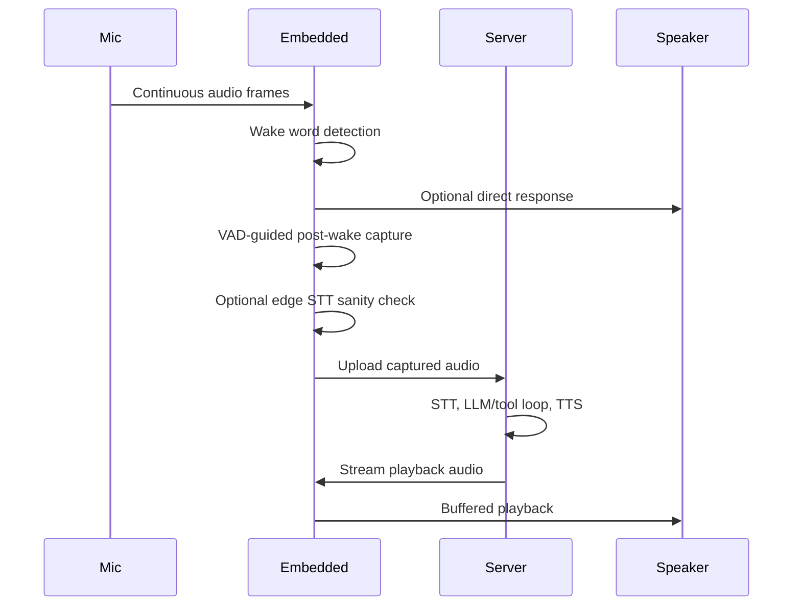

# Embedded Architecture

`alia-embedded` is the edge runtime for Raspberry Pi and local development. It
handles wake word detection, VAD, edge STT, direct response playback, audio
capture/playback, device binding, discovery, settings, and process/plugin
services.

## Main Responsibilities

- Keep the hot audio path local and responsive.
- Detect wake words with sherpa-onnx.
- Play direct response clips such as wake word, cancel, fallback, and listening
  prompts when configured.
- Capture user speech with VAD-aware timing and send it to the server.
- Play server TTS streams while supporting barge-in interruption.
- Expose embedded settings, direct response, volume, binding, process, and
  plugin services over gRPC.

## Module Slots

Embedded module selection is represented by `EmbeddedConfig.modules` and has
compiled defaults when the config file is missing.

| Slot | Typical implementation | Purpose |
| --- | --- | --- |
| `wakeword` | `sherpa_onnx` | Keyword spotting. |
| `edge_stt` | `sherpa_onnx` | Local speech recognition used before upload. |
| `vad` | `sherpa_onnx` | Voice activity detection and endpointing. |
| `direct_response` | `keyword` | Local audio response matching and playback. |
| `audio_capture` | `cpal` or ALSA fallback | Microphone input. |
| `audio_playback` | `cpal` or ALSA fallback | Speaker output. |
| `mixer` | `priority` | Playback priority and interruption behavior. |
| `face_tracker` | placeholder | Future local perception. |
| `discovery` | `mdns` | Device discovery and binding support. |

## Voice Loop

During playback, wake word detection can interrupt the active server turn. The
embedded node stops local playback immediately, sends an interrupt signal to the
server, skips the normal wake word direct response by default, and starts a new
capture window.

## Direct Responses

Direct responses are local audio clips and matching metadata. They are useful
for low-latency feedback and offline/fallback behavior. The system supports
configured response classes such as:

- `wakeword`
- `cancel`
- `fallback`
- `listening-start`
- `listening-continue`

Responses are optional. Missing audio should be logged as an error or warning,
but should not panic or block the rest of the voice flow.

Direct response audio files stay on disk. Configuration and imported metadata
are stored in embedded SQLite. Bundles under the direct response audio directory
can be discovered recursively and imported into the database.

## Local Storage

Embedded storage is intentionally split:

- SQLite stores small structured state such as binding state, volume settings,
  direct response rules, and imported response metadata.
- Disk directories store large or user-managed assets such as model files,
  direct response audio, debug WAV captures, and process/plugin bundles.

## Audio Notes

The embedded audio layer supports CPAL and a Linux ALSA fallback path. On Pi
audio boards, the capture and playback device may share a clock. Settings such
as source-rate following, capture alignment, playback buffer sizes, and debug
WAV recording exist to diagnose board-specific behavior without recompiling.
