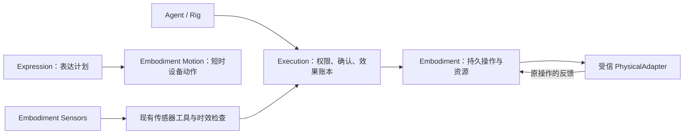

# Embodiment：具身交互基础

Embodiment 拥有物理观察、短时动作的设备证据，以及独立于对话回复的持久操作。
这一轮提供 Rust 领域契约、运行时与回归夹具，不安装 ROS、导航栈或新的硬件驱动。

## 代码归属

| 部分 | 当前入口 | 职责 |
| --- | --- | --- |
| 共享契约 | `crates/alia-core/src/embodiment/` | Motion 命令与证据、物理操作身份与状态；不依赖数据库、传输和模型 |
| 传感器 | `packages/alia-server/src/modules/embodiment/sensors/` | 定义、时效策略、读取、持久化和生命周期；保留现有 SensorRegistry 行为 |
| 短时动作 | `packages/alia-server/src/modules/embodiment/motion_delivery/` | 表达动作的规范 Response 关联、持久派发身份及设备证据 |
| 长任务 | `packages/alia-server/src/modules/embodiment/operations/` | Execution 授权后的操作记录、资源占用、适配器调用、观察与恢复 |
| 设备端 | `packages/alia-embedded/src/module/motion/` | 已有本地动作驱动、校准、租约和串口／I²C 提交 |
| 表达 | `packages/alia-server/src/expression/` | 情绪、表达意图、候选计划与最终宿主约束 |

旧 `alia_core::body`、`modules::body_delivery` 和 `platform::sensors` 入口已经移除。
Motion 的现行约定见 [Motion contract](motion-contract.md)。

## 执行与证据

Execution 记录提交或取消控制指令的效果；物理操作保存另一组事实。
开始工具成功表示操作已经持久登记，并返回 `submitting` 与原操作身份；
后续 `accepted` 反馈才表示设备已接受目标，二者都不表示设备已经到达目标。
取消工具对应一条新的 Execution 效果，不撤销、改写或重派原始效果。
查询始终限定当前账号，可以在适配器不再安装时读取旧操作。

操作在调用外部适配器前写入数据库，并固定原始 `operation_id`、
`start_effect_id`、账号、设备 ID、设备 boot ID、适配器版本及能力 pin。
适配器必须用这个操作 ID 实现幂等提交，并能查询同一个操作。
重启、通信超时或回执丢失后的恢复只观察原身份；不会换 ID 重新开始。

反馈同时携带原身份、递增序号、观察时间、状态、数据和可选的停止证据。
状态表达提交中、接受、运行、取消中、成功、失败、已取消及未知。
取消确认与停止证据分别存储；没有正面停止证据时，资源不会因为
调用超时、进程退出或任务进入终态就自动释放。
新鲜的后续观察可以补全事实，但不能改写原 Execution 回执。
每项操作保留最近 64 条领域事件；规范操作状态和原 Execution 账本独立持久保存。

资源名由受信适配器固定，按设备隔离，数据库保证操作之间的排他占用。
这套操作资源不能自动证明现有本地 Motion 驱动或车端其他程序也参与了仲裁。
后续适配器接入同一执行器时，必须把这些写入路径接到同一设备仲裁机制。

## Expression 的边界

Expression ABI 继续只返回表达候选；Extism guest 不取得设备、网络或工具调度权。
宿主最终检查会重新执行动作开关、能力白名单和强度等约束。
外部 planner 或 safety-policy 插件不能重新打开已禁用的自动动作。

短时表达 Motion 保留当前 Response／语音作用域、5 秒动作预算和本地校准约束。
独立物理操作没有 Response 生命周期依赖；结束一句话不会自动取消它。
真正的停止请求通过独立控制效果处理，实际停止仍须设备证据。

## 扩展接入

受信 Rust 代码通过 `ServerBuilder::with_embodiment_adapter` 绑定 `PhysicalAdapter`。
`AdapterDescriptor` 固定账号授权、设备身份、启动代次、能力、参数 Schema、
实现版本和排他资源。Schema 复用现有工具校验器，工具继续走 Execution。
注册代码本身不会发现或授权现实设备；描述符中的授权由可信装配代码提供。
完整工具实现摘要由 Execution 在派发前核对；Embodiment 再核对已派发效果的账号、
参数与来源。适配器和 service 的 Rust 接口属于受信宿主代码，不能直接映射成外部
控制 RPC；后续网络或插件接入仍须经过 Execution 工具入口。

适配器实现三个操作：`start` 提交原操作，`observe` 查询原操作，`cancel` 请求取消。
它必须验证下游设备身份、限制通信和反馈大小，并提供真实的完成与停止依据。
停止证据还必须保证同一操作 ID 的迟到请求不会重新产生动作；下游“查无此 ID”
不足以证明停止。支持取消尚未到达的请求时，适配器必须在设备端建立不可重启的
终结记录。数据库 advisory 锁负责宿主调用排序，断连会释放，不能替代设备 fencing。
运行时最多保留 8 个普通调用和 2 个独立取消调用；调用超时后仍持有原任务及容量，
直到调用真正返回。取消容量也有上限，不能代替车端独立急停与通信失效处理。
尚未提供 ROS、MCP 机器人桥、通用 shell 执行或自动发现并授权设备的实现。
普通启动没有虚构的导航或运动能力；只有查询历史操作的只读工具。

操作记录读取接口为：

- `GET /api/v1/embodiment/operations?limit=25`
- `GET /api/v1/embodiment/operations/{id}`

控制请求仍使用现有 `/api/v1/tools/execute` 和 `/api/v1/effects/{id}/confirm`。
接口没有另设绕过 Execution 的启动、取消或写反馈 HTTP 入口。

## 迁移与验收

历史 SQL 及迁移校验和保持原样。新增迁移把 Body 投递表和事件词汇迁为 Motion，
保留原命令、进度、未知状态和迟到检查点；随后创建物理操作、资源和取消关联表。
不会因为升级重新提交旧物理动作。

Motion RPC 改为 `alia.motion.v1.MotionControl`，签名域改为 `alia-motion-v2`，
旧 RPC 入口不保留兼容代理。Server 与 Embedded 必须成套升级；升级前应结束正在
执行的动作。历史记录仍可读取，读取不授予重新执行权限。

离线验收使用真实 PostgreSQL 和确定性 Rust 适配器，检查权限、确认、去重、
操作状态、取消、停止证据、资源互斥、陈旧反馈、恢复和 shutdown 所有权。
软件测试不证明现实设备已经停止，也不证明 ROS 互通、底盘限速或急停可用。
具体测试结果记录在 [软件验证记录](../operations/software-release.md)。

后续 ROS 接入应先针对目标发行版验证消息、Action、坐标系与 QoS，再用仿真和
已确认的车端停止机制验证断线、重启、重复请求及目标完成。其他具身设备沿用
同一操作契约，并按自身反馈能力定义完成与停止证据。
