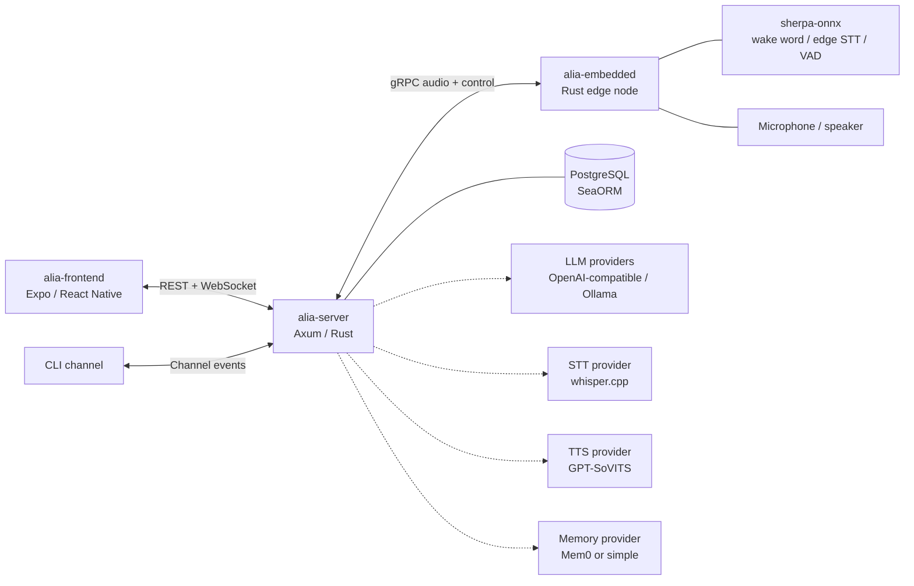

# Architecture Overview

Project Alia is a personal AI assistant split across a central server, one or
more embedded edge nodes, and a frontend app. The server owns orchestration,
state, model-provider selection, and user-facing APIs. Embedded nodes own local
audio I/O, wake word detection, direct responses, device binding, and playback.

## Packages

| Path | Role |
| --- | --- |
| `packages/alia-server` | Main server, API, AI pipeline, channel adapters, module lifecycle, provider adapters, registry, scheduler, tools, and persistence. |
| `packages/alia-embedded` | Edge runtime for Pi or local dev, including audio capture/playback, wake word, VAD, edge STT, direct responses, binding, discovery, and process/plugin services. |
| `packages/alia-frontend` | Expo/React Native application for user-facing UI, settings, onboarding, and runtime control. |
| `crates/proto` | Shared protobuf definitions and generated Rust code for gRPC services. |
| `crates/transport` | Shared transport/auth helpers used across server and embedded communication. |

## Runtime Responsibilities

- The server is the coordinator. It receives channel events, routes requests,
  selects skills/tools, talks to model providers, stores conversation history,
  and sends responses back to channels.
- Embedded nodes are latency-sensitive edge clients. They handle wake word and
  local audio behavior before sending a captured utterance to the server.
- The frontend is not in the hot voice path. It manages settings, devices,
  conversations, plugins, and observability.
- Model services are external providers behind adapters. The core runtime should
  be able to swap them without rewriting pipeline logic.

## Design Direction

- Keep module selection explicit. The `[modules]` section in server config
  chooses active implementations; provider files configure those implementations.
- Keep channel behavior channel-local. Voice interruption and playback semantics
  belong to the embedded channel, not to a global server policy.
- Prefer streaming where it improves perceived latency. The pipeline supports
  streaming LLM output, streaming TTS, and streamed channel audio delivery.
- Degrade instead of crashing. Provider failures should disable or skip the
  affected module/channel path where possible, while leaving the process alive.
- Treat plugins as future first-class owners. Tools, skills, settings, and
  dependencies are registered with ownership metadata so removal can be safe.
