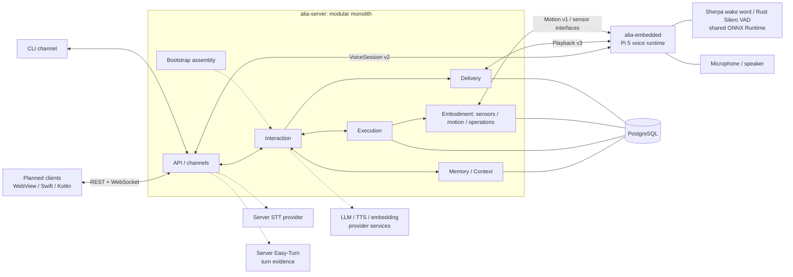

# Architecture Overview

Project Alia uses a Rust server modular monolith and an embedded realtime voice
runtime. The server owns canonical Memory and Context, Interaction, Companion,
Execution, Embodiment, Delivery, persistence, model selection, and APIs. Embedded owns local
audio I/O, wake word detection, scoped cues, device binding, and native playback.
The current targets are a macOS server and Raspberry Pi 5 with 8 GB RAM;
existing Linux ARM64 validation supports the server portability work.

Detailed package docs live beside the packages:

- [alia-server docs](../../packages/alia-server/docs/README.md)
- [alia-embedded docs](../../packages/alia-embedded/docs/README.md)

The diagram shows ownership and main contracts, not every call. Companion uses the same
Context and Delivery authorization rather than creating a separate output path.
Memory is an internal canonical service; external embedding or extraction
models only supply inputs to it.

## Packages

| Path | Role |
| --- | --- |
| `packages/alia-server` | Bootstrap, domain services, API and channel adapters, provider integrations, registries, and PostgreSQL persistence. |
| `packages/alia-embedded` | Continuous capture, wake word, VAD evidence, scoped voice/cue mixing, typed Motion execution, binding, discovery, and sensors. |
| `crates/alia-core` | Shared types and contracts for the server and embedded runtime. |
| `crates/proto` | Shared protobuf definitions and generated gRPC code. |
| `crates/transport` | Shared transport/auth helpers. |

## Runtime Responsibilities

- Interaction owns bounded input supervision, turns, cancellation, generation,
  tool coordination, and response persistence. Bootstrap supplies explicit
  service dependencies. Channel adapters own transport rather than a parallel
  conversation pipeline.
- Memory owns stored memories, provenance, privacy transitions, retrieval
  projections, Context leases, and completed-turn capture. Policy determines
  recall/capture eligibility; it does not replace canonical storage with a
  provider or no-op backend.
- Execution records authorized tool effects; Delivery records canonical response
  and media facts. Generation success, transport acceptance, and physical
  completion remain different facts.
- Embodiment owns sensor observations, bounded Motion delivery, and persistent
  physical operations. Expression generates expressive plans; independent
  operations retain their own identity beyond response completion. Trusted
  adapters receive Execution-authorized commands and return device evidence.
  The foundation has no default robot or ROS transport.
- Easy-Turn stays server-side and supplies bounded evidence. Server policy
  decides turn transitions, temporary yield, and explicit pause/resume.
- Embedded opens a continuous VoiceSession after wake word and keeps uploading
  ordered PCM plus VAD evidence during playback. Voice and low-gain local cues
  share the scoped native output owner and frame clock. This mixer is not AEC.
- Planned frontends will manage settings, devices, conversations, and observability.
  The previous frontend is removed; replacements are not implemented. See the
  [frontend plan](../../README.md#planned-frontends). Frontends are not required
  in the realtime voice path.

## Current Migration And Remaining Work

The 2026-10-08 migration moves Memory out of `providers`, replaces the old
`channels/pipeline` owner with Interaction use cases, and places service
assembly in `bootstrap` with lifecycle/task ownership in `modules/platform`.
The old paths have no compatibility facade. Default Shadow and persisted
policies remain unchanged.

Conversation, cache, persona, router and skills now live under Interaction;
Insights remains under Platform. Sensors and the former Body delivery owner
live under Embodiment. The Body namespace and protocol have been replaced by
Motion, with a database migration that preserves historical evidence. See the
[Embodiment contract](embodiment.md) for the adapter boundary, state semantics,
and coordinated Server / Embedded upgrade requirements.

Future edge model execution and deploying server plus embedded on one machine
remain possible directions, not completed deployment modes. The Embodiment
foundation adds no ROS dependency, separate process or hardware action.
Concrete robot adapters, frontend improvements, acoustic AEC and
physical Motion validation remain deferred as recorded in the refactor handoffs.
