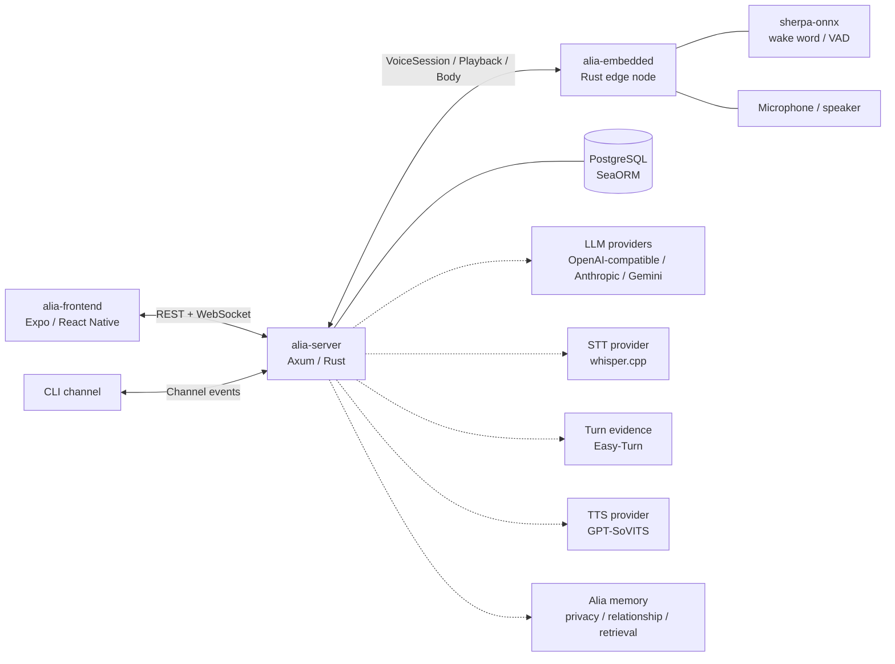

# Architecture Overview

Project Alia is a personal AI assistant split across a central server and
embedded edge nodes. The server owns Context, Interaction, Execution, Delivery,
state, model-provider selection, and user-facing APIs. Embedded nodes own local
audio I/O, wake word detection, scoped cues, device binding, and native playback.
The existing frontend app is outside the current Server and Pi 5 refactor scope.

Detailed package docs live beside the packages:

- [alia-server docs](../../packages/alia-server/docs/README.md)
- [alia-embedded docs](../../packages/alia-embedded/docs/README.md)

## Packages

| Path | Role |
| --- | --- |
| `packages/alia-server` | Main server, API, AI pipeline, channel adapters, module lifecycle, provider adapters, registry, scheduler, tools, and persistence. |
| `packages/alia-embedded` | Edge runtime for Pi or local dev, including continuous capture, wake word, VAD evidence, scoped voice/cue mixing, typed Body execution, binding, discovery, and sensors. |
| `packages/alia-frontend` | Expo/React Native application for user-facing UI, settings, onboarding, and runtime control. |
| `crates/proto` | Shared protobuf definitions and generated Rust code for gRPC services. |
| `crates/transport` | Shared transport/auth helpers used across server and embedded communication. |

## Runtime Responsibilities

- The server accepts recognized turns through Context and Interaction, executes
  skills/tools with owned effects, and sends responses through Delivery. Easy-Turn
  supplies bounded turn evidence; server policy decides response and pause actions.
- Embedded nodes open a continuous VoiceSession after wake word and keep uploading
  ordered PCM plus VAD evidence during playback. Voice and short local cues share
  the original scoped native control owner and one output frame clock.
- The frontend is not in the hot voice path. It manages settings, devices,
  conversations, plugins, and observability.
- Model services are external providers behind adapters. The core runtime should
  be able to swap them without rewriting pipeline logic.

## Design Direction

- Keep provider selection explicit. The `[modules]` section in server config
  chooses active provider adapters; provider files configure those adapters.
  Core registries and state machines are fixed services extended through
  registration APIs.
- Keep transport details in channel adapters. Shared Interaction and Delivery
  services own turn, pause, cancellation and response contracts; adapters carry
  those contracts to the original authenticated device scope.
- Prefer streaming where it improves perceived latency. The pipeline supports
  streaming LLM output, streaming TTS, and streamed channel audio delivery.
- Degrade instead of crashing. Provider failures should disable or skip the
  affected module/channel path where possible, while leaving the process alive.
- Treat plugins as future first-class owners. Tools, skills, settings, and
  dependencies are registered with ownership metadata so removal can be safe.
- Keep sensors in one server-visible plane. Embedded owns concrete sensor
  providers, while the server mirrors definitions/readings into the shared
  sensor registry for tools, scheduler, rules, and frontend APIs.
