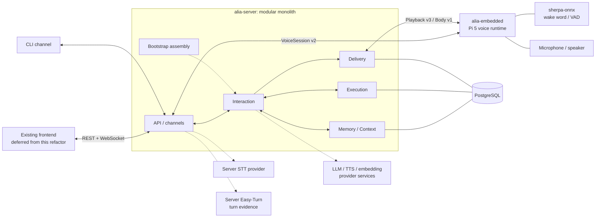

# Architecture Overview

Project Alia uses a Rust server modular monolith and an embedded realtime voice
runtime. The server owns canonical Memory and Context, Interaction, Companion,
Execution, Delivery, persistence, model selection, and APIs. Embedded owns local
audio I/O, wake word detection, scoped cues, device binding, and native playback.
The current targets are a macOS server and Raspberry Pi 5 with 8 GB RAM;
existing Linux ARM64 validation supports the server portability work.

Detailed package docs live beside the packages:

- [alia-server docs](../../packages/alia-server/docs/README.md)
- [alia-embedded docs](../../packages/alia-embedded/docs/README.md)

The diagram shows ownership and main contracts, not every call. Companion uses the same
Context and Delivery authorization rather than creating a separate output path.
Memory is an internal canonical service; external embedding or extraction
models only supply inputs to it.

## Packages

| Path | Role |
| --- | --- |
| `packages/alia-server` | Bootstrap, domain services, API and channel adapters, provider integrations, registries, and PostgreSQL persistence. |
| `packages/alia-embedded` | Continuous capture, wake word, VAD evidence, scoped voice/cue mixing, typed Body execution, binding, discovery, and sensors. |
| `packages/alia-frontend` | Existing Expo/React Native UI; web/iOS/Android improvements are deferred. |
| `crates/alia-core` | Shared types and contracts for the server and embedded runtime. |
| `crates/proto` | Shared protobuf definitions and generated gRPC code. |
| `crates/transport` | Shared transport/auth helpers. |

## Runtime Responsibilities

- Interaction owns bounded input supervision, turns, cancellation, generation,
  tool coordination, and response persistence. Bootstrap supplies explicit
  service dependencies. Channel adapters own transport rather than a parallel
  conversation pipeline.
- Memory owns stored memories, provenance, privacy transitions, retrieval
  projections, Context leases, and completed-turn capture. Policy determines
  recall/capture eligibility; it does not replace canonical storage with a
  provider or no-op backend.
- Execution records authorized tool effects; Delivery records canonical response
  and media facts. Generation success, transport acceptance, and physical
  completion remain different facts.
- Easy-Turn stays server-side and supplies bounded evidence. Server policy
  decides turn transitions, temporary yield, and explicit pause/resume.
- Embedded opens a continuous VoiceSession after wake word and keeps uploading
  ordered PCM plus VAD evidence during playback. Voice and low-gain local cues
  share the scoped native output owner and frame clock. This mixer is not AEC.
- The frontend manages settings, devices, conversations, and observability; it
  is not required in the realtime voice path.

## Current Migration And Remaining Work

The 2026-10-08 migration moves Memory out of `providers`, replaces the old
`channels/pipeline` owner with Interaction use cases, and places service
assembly in `bootstrap` with lifecycle/task ownership in `modules/platform`.
The old paths have no compatibility facade. Default Shadow and persisted
policies remain unchanged.

This is a completed ownership slice, not the end of the architecture refactor.
Fixed conversation, cache, persona, router, skills, insights, and sensor services
still live under `providers`, and some non-Memory contracts remain grouped in
`providers/adapter.rs`. Context/Companion/Delivery transaction boundaries and
the broad startup `ModuleContext` need separate review. See the
[server architecture](../../packages/alia-server/docs/architecture.md) and
[current checklist](../refactor/checklists/layering-2026-10-08.md) for precise
ownership and validation status.

Future edge model execution and deploying server plus embedded on one machine
remain possible directions, not completed deployment modes. This round adds no
new Cargo feature, dependency, process, platform, model runtime, or hardware
action. Generic embedded adaptation, frontend improvements, acoustic AEC and
physical Body validation remain deferred as recorded in the refactor handoffs.
