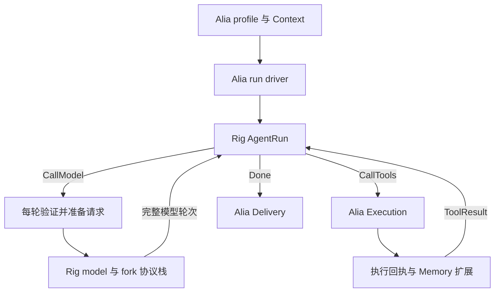

# Rig 0.44.0 深度接入调研

初始调研日期：2026-10-18。研究时尚未修改 Alia 实现或 Cargo 依赖；实施状态见下文更新。

本文保留实施前对 Rig 0.44.0 的源码调研，作为设计依据；下文的“建议”和 F1–F8 表描述的是原始迁移计划，不代表当前仍未实施。工具声明、MCP、Extism 另有专项记录。

**实施状态（2026-10-18）**：Alia 已使用 `LlmService`、Rig 原生消息和手动驱动的 `AgentRun`，移除了 `LlmAdapter`、自写 provider/SSE parser 和 `alia.tool_calls.v1` 文本工具 fallback。工具调用继续由 Execution 派发，每轮复验来源 Context，memory_search 通过规范回执扩展上下文，最终总结轮禁止追加执行。领域 `ChatMessage` 仅保存用户历史及来源身份，native reasoning 保留在临时模型 transcript 内。

维护的 fork 固定为 [`c2ff3e30e6b8d84fc6759eab030656a42cae14ca`](https://github.com/Ke-Qiao/rig/tree/c2ff3e30e6b8d84fc6759eab030656a42cae14ca)。实际修复范围见 [ALIA_PATCHES.md](https://github.com/Ke-Qiao/rig/blob/c2ff3e30e6b8d84fc6759eab030656a42cae14ca/ALIA_PATCHES.md)，完整四包验证记录见 [ALIA_TEST_RESULTS.md](https://github.com/Ke-Qiao/rig/blob/c2ff3e30e6b8d84fc6759eab030656a42cae14ca/ALIA_TEST_RESULTS.md)：1677 项单元测试和 273 项文档测试通过，未运行真实模型与设备验证。当前 Alia 使用 Rust 1.96 和统一 reqwest 0.13；下面关于旧接口与旧依赖的分析是历史基线。

## 1. 结论与证据范围

**建议采用经过定向 fork 的 `rig-core + rig-agent`，整体替换现有 provider 解析和普通 tool round-trip。使用手动驱动的 `AgentRun`，由 Alia 决定什么时候调用模型、什么时候进入 Execution、什么时候允许 Delivery。**

这比维持原 `LlmAdapter`、原 provider parser、原文本工具协议，再在中间加一个 Rig 适配器更完整。Rig 能接管协议与轮次；Context 来源验证、设备与用户权限、Execution 账本、Delivery 冻结和取消所有权仍是 Alia 的领域行为，不应交给通用 agent 框架推断。

这不是“直接加依赖即可上线”。已发现的关键差异包括终态、参数宽松归一化、资源预算和流式取消后的收尾。仅实现有界 `HttpClientExt` 不能修复这些差异，必须修改 Rig 内的共享 framing / completion fold 和 provider decoder。下文给出可分提交维护的修改表。

本次依据 crates.io 实际发布的四个 `0.44.0` 源码包；它们的 `.cargo_vcs_info.json` 均指向：

`2d1071e0e0c602f994e9d6cfd8cf5faea6f53650`

`rig-core` 与 `rig-agent` 发布于 **2026-10-07**，距调研日只有 11 天；edition 为 2024，MSRV 为 **Rust 1.95.0**，许可证为 **MIT**。这是这次拆分后 API 的年龄，不能据此将 `AgentRun` 描述成长期生产验证过的稳定接口。仓库 main 已有与发布包不同的 API，不能混用 main 示例和 `0.44.0`。具体元数据见 [rig-core 发布记录][core-release]、[rig-agent 发布记录][agent-release]，代码见 [core manifest][core-manifest]、[agent manifest][agent-manifest]。

`rig-harness` 当前公开包仍是占位包，不属于可接入能力。本设计只使用有实际实现的 `rig-agent`。没有调用真实模型，没有构建整个 Rig 工作区，也没有验证上线性能或所有第三方 OpenAI 兼容服务。

## 2. 完整替换后的职责

`AgentRun` 是不拥有模型、工具或 I/O 的状态机。发布版返回三个步骤：`CallModel { prompt, history, turn }`、`CallTools { calls }`、`Done(response)`。模型 handle 可用 `DynModel<Completion>`，它直接提供 `call` / `stream`，不会执行工具。手动驱动确实可以替换 Alia 自写的普通轮次循环，而非只能包一层 provider。[AgentRun][run]、[DynModel][dyn-model]

| 层 | 目标职责 | 应删除或替换的旧路径 |
|---|---|---|
| Rig core 与 fork transport | 请求编码、原生工具协议、三 provider 解析、流聚合、usage、原生推理元数据 | `providers/llm` 中旧请求/响应 DTO、SSE decoder、provider 特有拼接和 JSON 解析 |
| Rig AgentRun | 消息轮次、工具结果配对、正常完成、模型调用次数与受控 recovery | `interaction/tools.rs` 的普通模型—工具—模型循环 |
| Alia profile 管理 | 配置、default/minor/major 选择、secret 注入、生命周期、健康状态、config generation | `LlmAdapter` 的通用聊天抽象可删除；生命周期管理改为领域 service 持有 Rig model handle |
| Alia run driver | 每轮 Context 校验、请求物化、预算与取消、执行调度、最后 Delivery | 保留领域逻辑，使用 Rig 步骤驱动；不保留第二套轮次状态机 |
| Alia Execution | 工具授权、幂等、持久结果、取消后的资源回收、MCP/插件真实调用 | 所有实际工具实现仍只从此入口到达 |
| Alia Context / Memory | 来源、隐私、memory_search 回执验证、上下文扩展 | 不替换成 Rig 的普通 RAG 文档检索 |
| Alia Delivery | 冻结响应上下文、用户文本/语音流、交付与打断 | Rig 事件只作为输入，不绕过现有 Delivery |

建议的调用链：



三个必要接口足以承载领域行为；不需要在 Rig 内加入 Alia 数据库类型：

1. **模型步骤接口**：带着当前 Context 与 profile generation，物化 `PreparedRequest`，计算剩余额度，执行 Rig model。重试也重新经过这一入口。
2. **工具步骤接口**：将原生 call 送入 Execution，完成回执验证、`extend_execution` 和必要的 `extend_memory`，将规范化的模型可见结果回填。
3. **完成/文本事件接口**：只向 Delivery 提交符合终态和上下文约束的输出；纯文本流仍受 Delivery owner 和有界 TTS 队列管理。

## 3. 手动 AgentRun 如何与 Context 连续运行

### 3.1 CallModel

源码事实：`prepare_request` 负责由 `RunSpec`、capabilities、history、tools、patch 组成请求；`RequestPatch` 支持 `preamble`、`extra_context`、`history`、`active_tools` 等每轮覆盖。patch 不会自动延续到下轮；多个 allowlist 会相交，history 是后者覆盖前者。[prepare_request][prepare]、[RequestPatch][patch]

建议按以下顺序驱动：

1. 保留 Alia turn owner、初始 Context 身份、当前绑定、取消 token、原始绝对 deadline；不把这些 capability 序列化进 Rig 状态。
2. 每个 `CallModel` 先重新验证绑定、来源授权和 profile 状态，包括工具成功后的下一轮及 recovery 轮。
3. 由 Context 物化当前系统约束和 memory 证据；普通会话消息、当前 run 的 assistant/tool transcript 和检索证据分别组装，避免把上一轮已物化的 memory 文本再次当成无来源普通历史带回。
4. 调用 `prepare_request`，记录这一轮实际 advertised definitions。`advertise_tools` 仅记录数据，不替代权限检查。
5. 模型返回后，先执行严格 finish/预算检查，再用 `ModelTurn::from_response(response, prepared)` 或流式路径回填。必须使用这一轮的 prepared 数据，避免 advertised 与 allowed 集合漂移。

`RequestPatch.history` 足够支持重新物化请求，但并不自动改写 `AgentRun` 原始历史。因此建议检索证据通过当前请求的 preamble/documents 传入，并把 run transcript 保持为用户输入、模型消息及规范工具结果。若现有提示词确需重写完整 history，必须保证 audit 指向实际 prepared request，而不是把 `AgentRun.full_history` 误报为实际发给模型的输入。

来源撤销时应终止本次运行；不通过“删几个字段再重试”把原来不再授权的材料继续留在诊断、签名或 raw payload 中。Context 扩展则是已验证来源的增加，可重新物化下一轮。

### 3.2 CallTools 与 memory_search

发布版 `PendingToolCall` 是包含 `tool_call` 与 `preresolved_result` 的 struct，不是 main 分支中后续出现的类型化执行接口。宿主必须处理预解决结果，且不为它执行实际工具。`tool_results` 要求一批结果完整配对待处理调用；相同 provider call ID 可作为多重集出现，因此不能只用 call ID 作为 Execution 唯一键。[PendingToolCall 与 tool_results][run]

建议保持当前 Alia 语义：

- 在任何执行前核对非空名称、调用身份、完整且严格的参数、当轮 advertised 工具集合以及当前权限；所有调用先做结构预检，避免执行第一项后才发现同批第二项参数损坏。
- 按模型轮次和 call ordinal 生成稳定 invocation 身份，并绑定原始 Alia turn / context；provider call ID 用于协议配对，不能承担授权或幂等职责。
- 初次迁移保持串行执行。`CallTools` 是批次并不要求并发；并发会改变 Context 扩展顺序与设备副作用顺序，需另行证明。
- Execution 返回持久完成记录后核对 canonical tool、call identity、effect 和结果状态。失败是规范失败结果，不能伪造成功。
- 只有已确认成功的内建 `memory_search` 回执与有效查询参数，才能触发 `extend_memory_with_opts`。普通 MCP 查询或扩展工具不能只因名称相似而获得 memory 来源权限。
- 按现有代码保留 turn Context 锁覆盖执行回执与 Context 扩展的顺序约束。生成已冻结的响应不能再扩展 Context。
- 工具运行期间若用户取消响应，Execution owner 仍负责完成或确认取消、资源释放和账本落地；禁止仅丢弃 await future 就假装副作用不存在。回到 driver 后停止后续模型和交付。

MCP/Extism 可以拥有 Rig 工具 schema 的投影，但真实执行必须落到同一个 Execution dispatch。不要同时启用 Rig 自动 `ToolSet` 执行和 Alia Execution。`ToolContext` 是可序列化数据；只允许放 invocation/execution ID 等非授权元数据。取消 token、数据库连接、凭据 broker、设备 owner 留在宿主对象或 side map，由原 owner 管理生命周期。

### 3.3 Streaming 的连续性

源码事实：`StreamedTurnAssembler` 聚合文本、reasoning 和工具片段，`finish` 从完整 `CompletionResponse` 取内容。发布版要求先调用一次 `record_streamed_completion_call` 记录真实终态 metadata / usage，再 `streamed_turn`。不能在缺失真实终态的 EOF 上伪造完成记录。[streamed assembler][streamed]、[streamed recording][run]

建议所有 provider 使用一条严格解析路径；聚合调用也走同一 fold。实际步骤是读取事件、维护 assembler、等待严格 terminal、取得完整 response、核对 finish policy、记录 completion call、回填 streamed turn。

对于当前 Alia 的工具 turn，**先内部 streaming、后一次性交付**。工具轮次中的 assistant 文本可能是中间推理后的行动说明；提前提交 Delivery 会冻结 Context，破坏后续 memory_search 扩展。初次替换不改变这个行为。

对于不含工具的纯文本 turn，可以继续把已验证的 Text 事件送入现有有界 Delivery/TTS 管线，reasoning、signature、opaque item 不进入用户文本。但流的最终成功状态必须等待正确终态；如果用户已经听到前缀后流失败，记录部分交付，不能把它标成完整回复。严格 terminal 无法撤回已经播放的声音。

### 3.4 状态保存不是执行恢复授权

`AgentRun` 可序列化，不等于它能安全恢复 Alia 的外部副作用。首轮迁移建议只保存在途内存状态，不直接把完整 Run dump 写入会话表。

若后续实现恢复，必须保存版本化的 run 状态、模型身份、Context 引用、已提交 Execution ID 和一次性结果提交位置；恢复时重做 Context / 权限检查，并从账本查询已完成结果。重复收到 `CallTools` 只可复用同一 invocation 的账本结果，不能重做操作。缺失完成状态时按 unknown 处理，不能推测失败后重试。

## 4. Provider、终态和 reasoning 数据

| API | 0.44.0 源码事实 | Alia 所需策略 |
|---|---|---|
| OpenAI Chat Completions | `ChatDecoder.eof` 在已有 finish reason 时允许没有 `[DONE]` 的 EOF；源码解释为兼容部分方言 | 官方 profile 要求完整 SSE event、合法 finish reason 和 `[DONE]`。兼容服务仅在显式 dialect profile 和 fixture 证明后允许 EOF 终态 |
| OpenAI Responses | 以 `response.completed` / `response.incomplete` 等事件收口；`[DONE]` 本身不表示 completed | 仅接受真正 completed；incomplete、failed、cancelled、拒绝或不完整工具调用不进入 Execution |
| Anthropic Messages | `message_delta` 有 stop_reason 就直接 `Flow::Ended`；`message_stop` 是忽略事件 | 先暂存 stop reason/usage，继续等 `message_stop`，并验证 block 收口；之后才提交成功 |
| Gemini generateContent streaming | 正常 Stop / Length 持续读取至 EOF，缺 finish reason 返回 Truncated；失败 reason 提前结束 | Gemini 无须人为加 `[DONE]`；要求合法 candidate、完整 SSE framing 和允许的 finish reason。Length 不执行工具 |
| OpenAI 兼容端点 | 提供 dialect/quirks、API 与 endpoint 配置 | 兼容性是 profile 明确属性，不由模型名字猜测；未知 dialect 不自动放宽终态或输入合法性 |

事实来源：[Chat decoder][chat]、[Responses decoder][responses]、[Anthropic decoder][anthropic]、[Gemini decoder][gemini]、[OpenAI wire/dialects][openai-wire]。

**长度上限不能默认当成功。** Rig 的共享 `turn_failure` 明确允许某些 Length 轮次中的完整 tool call 执行；Alia 需要在回填和执行前采取更严格 finish policy。这个语义检查可基于 Rig 的结构化 finish 值实现，不需要另一套 wire parser。[turn_failure][message]

**原生推理内容应保留在模型 transcript 内。** Rig 能在 canonical message 旁保留 provider-native item，包括 Anthropic thinking signature、Gemini thoughtSignature、Responses encrypted reasoning。native replay 同时考虑 API/provider/model 身份与 canonical fingerprint；部分 Anthropic 模型还绑定系统提示与工具集的 context fingerprint。[native 元数据][native]、[history adaptation][history]、[Anthropic replay][anthropic-wire]

因此可以保留同一次工具往返的签名，而无需把它压成现有 `ChatMessage.content` 字符串。代价是必须区分三种数据：

- 用户可见会话记录：角色、已交付文本、允许展示的工具摘要。
- 当前模型 transcript：签名、原生工具消息、reasoning native block，仅用于受控 replay。
- 运行证据：Context / Execution / Delivery ID、预算、错误分类和脱敏 usage，不默认复制 raw body。

Rig 的 fingerprint 是用于内容一致性的 64-bit FNV，不是授权签名，也不是可代替 Alia 来源链的密码学证明。跨 provider/model 切换应由 Rig 进行合法 canonical adaptation；不能强制复制不兼容 native 数据。Context 扩展改变 prompt/tools 后可能使绑定上下文的 native item 不再可重放；这是需要 fixture 和真实模型阶段单独验证的迁移风险，不应通过伪造旧 context fingerprint 绕过。

Provider hosted tools（如供应商托管搜索/代码执行）也可能产生副作用和外部来源。初期只允许宿主声明的 function tools；若将来启用 hosted tools，需要专门的来源与执行契约，不能当普通模型生成自动放行。

## 5. 严格参数与身份：不能只查 invalid_arguments

发布版 `ToolFunction` 会将空文本、JSON `null`、部分双编码 JSON 对象归一化，截断对象会被解析成 partial arguments，并另存 `invalid_arguments`。这使宽松模型易于恢复，但不符合当前 Alia 对工具输入的严格契约。只检查 `invalid_arguments.is_none()` 无法识别已经被当成合法对象的 `null` 或双编码输入。[ToolFunction][message]、[parse_tool_arguments][json-utils]

建议在 fork 的 provider-to-canonical 边界统一明确：

- 工具参数要求完整 JSON object。空参数必须按该 API 明确允许的形态表达；“字段缺省允许空对象”和“字段存在但类型不对”分开处理。
- 合法的 JSON null、array、scalar 不是对象；不能修补成可执行参数。
- 双编码输入仅在显式兼容 dialect 中允许一次，不能作为所有 provider 的默认行为。
- partial JSON 可作为 UI 预览或脱敏诊断；永远不能成为 Execution 参数。
- 官方 OpenAI / Anthropic 中协议要求存在的 provider ID 缺失时拒绝。Gemini 等协议原本可能不发 ID 的路径允许生成 host call ID，但记录它是宿主身份，不能伪称 provider 身份。
- 同一 turn 的重复 call ID、空白名称、名称中途改变、序号稀疏或冲突都应有明确拒绝/配对策略。建议对执行型调用拒绝重复 ID；Execution 唯一键仍使用 turn + ordinal。
- 无论工具由 Rust typed schema、MCP 还是 Extism 构建，执行前都进行 schema/语义验证。schema 被广告给模型并不保证输入已验证。

`Arguments` 并非完全无限：源码有固定 **32 MiB / call** 上限，超限会截断并打 invalid flag。但这不是立即失败，而且不能覆盖文本、reasoning、native/raw、framer、call 数和 run 历史。因此该上限需要改为统一配额的可配置、遇限失败机制。[shared completion accumulation][completion]

## 6. 可维护 fork 修改表

以下是建议提交单元，均在一个 fork 基线内修改；不在 Alia 复制整个 decoder。新类型名为设计建议，尚不存在于上游 `0.44.0`。

| 提交 | 修改位置 | 改动与边界 | 最小验收 |
|---|---|---|---|
| F1 严格有界 framing | `rig-http/src/http_client/framing.rs`；core `driver/http_transport.rs` 调用点 | 增加 fallible 严格 UTF-8 解码；保留跨 chunk BOM/CRLF/多字节；line/event/pending/total 计数在追加前核验；SSE EOF 检查未完成 data event | 所有 byte cuts；非法 UTF-8；大单 chunk；长注释/空行；未结束 event；边界等于/超限 1 |
| F2 读取与 HTTP 失败体预算 | `rig-reqwest/src/lib.rs` 与 HTTP request 附带的只读 limits | unary 和 non-2xx 改为逐块有界读取，禁止无限 `bytes()/text()`；stream 同一总额；content length 仅早期拒绝，不能代替实际计数；deadline 同时覆盖 headers/body | chunked 和无长度 body；超大 4xx/5xx；慢 headers/慢 body；取消后不再 poll |
| F3 shared fold / raw 预算 | `rig-core/src/operation/completion.rs`、`wire.rs`、`driver.rs`、各 document reassembler；`rig-agent/run/streamed.rs` | 共享 request read limits：text、reasoning、arguments、native、item/call count、raw 与累计 retain；超限立即出错，停止输入；限制未知事件与诊断保留；避免 assembler 无谓第二份全文 | 多个小 event 累计超限；很多小 tool call；超长 reasoning/signature；native backfill；未知 JSON；限额后无 Done/执行 |
| F4 Chat 终态策略 | `providers/openai/wire/chat.rs` 与 dialect policy | 官方 SSE 只有 DONE 才收口；finish reason 暂存，usage 继续收取；EOF 兼容只限显式方言；whole/unary 与 streaming 分开 | finish + EOF 失败；DONE 缺 finish 失败；正常 usage 后 DONE 成功；显式无 DONE 方言 fixture |
| F5 Anthropic 真正终态 | `providers/anthropic/streaming.rs` 与 document 收尾 | message_delta 暂存，message_stop 提交；检查 message/block 顺序和未闭合 block；保留 stop 前 error、signature/usage | delta + EOF；delta 后 error；漏 block_stop；合法 signature 分片和 message_stop |
| F6 严格参数与身份 | `completion/message.rs`、`operation/completion.rs`、各 provider 解码入点 | strict object policy 在宽松归一前执行；取消空/null/partial 自动可执行化；保留无效原文标记但不执行；身份要求按 API | malformed、truncated、null/array/scalar/双编码、空 ID、重复 ID、Gemini 无 ID 合法路径 |
| F7 明确 finish / opaque 策略 | shared response policy 与 provider terminal normalization | Alia strict 配置拒绝 Length、unknown finish、未完成 output item；content-bearing unknown 不静默丢失后仍成功。明确区分 provider hosted / opaque 内容 | Responses incomplete/failed；Gemini Length/安全拒绝；未知仅 metadata 与未知 assistant 内容分别验证 |
| F8 有界 recovery 与敏感状态保留 | `rig-agent/run` 和 shared observation / raw retention | 提供安全失败策略及可选禁用 raw retention；所有 recovery 使用同一预算；无真实 terminal 不能记录成功；避免为收 usage 无限 drain；不要序列化 capability | recovery 计数；取消后不 drain；省略 raw 仍保留 native replay；诊断不携带 secret/raw reasoning |

F7 的 **Alia 是否接受 Length / unknown finish** 可以先放在宿主的结构化结果策略中；无需因产品策略重写 provider。F1、F4、F5、F6 的原始字节、终态和类型丢失问题则必须在 Rig 内改。F3 应集中在共享 accumulation 和 raw 策略；只有 provider 自己保有额外重组缓冲的地方需要局部补额。

共享层的核查入口：[SSE framer][framing]、[HTTP transport][http-transport]、[reqwest body 读取][reqwest-source]、[completion fold][completion]。这些文件与上述 provider decoder 均来自同一发布 commit。

预算并不等于精确堆内存限额。`serde_json::Value`、clone、native 重组可能造成倍数放大；方案必须同时限制 JSON 深度/节点数、item 数和不同 retained 副本。`Out::edit` 当前允许任意 closure 更新 native item，不能仅在之后测结果大小就声称“分配前限制”。可优先把受限 provider 的大内容修改改成统一有界 append/replace；同时以 frame/body 上限约束不可避免的一次解析临时量。精确最大 RSS 仍需压力测试。

对于 UTF-8 的严格模式，这是相对 SSE 默认容错行为更严格的应用契约，不应声称上游按 WHATWG 的 replacement 行为本身就是标准错误。

## 7. 预算、取消与重试副作用

### 7.1 一次 run 的预算不能在重试时重置

建议保留当前 Alia 已有的 **4 MiB response、256 KiB line、1 MiB event、256 KiB delivery text** 作为迁移起点，再为 reasoning、tool arguments、raw、工具结果、history、call 数设置明确额度。数值需在实际模型 fixture 上评估；它们不是 Rig 默认值。

应区分并同时执行：

| 预算 | 控制点 |
|---|---|
| 绝对 deadline | run owner 持有；模型读取、重试等待、Execution 调度都使用同一截止时间 |
| 单次连接/读取超时 | configured reqwest client；短于或等于剩余 run 时间 |
| 单次/累计字节 | transport 解码后 bytes、framer、canonical fold、run history / tool result |
| 单次 output token 上限 | `PreparedRequest.max_tokens`，只是给 provider 的请求参数，不能替代本地限制 |
| 模型调用次数 | `AgentRun.max_turns`，覆盖初始、续轮和模型 recovery |
| 工具次数与结果大小 | Execution dispatch 与回填前；批量 tool calls 也不能超额 |
| usage 记录 | 保留 provider 来源和实际返回值；缺失是 unknown，不记成零 |

Rig 的 usage 可用于现有运行记录。本轮不新增成本预留或计费系统；取消本地读取也不代表远端未生成或未计费。

### 7.2 取消

源码事实：`Streamed` 停止 poll 会暂停，drop 会释放读取 future；bundled reqwest runtime 用 reactor context 包装，未为单次请求另起 detached request task。[Streamed][streaming-core]、[reqwest runtime][reqwest-runtime]

这支持 Alia 用 `select!` 驱动 cancellation/deadline 后 drop model stream。仍需区分：

- 模型 I/O：本地停止读取，不保证远端立刻停止生成或不计费。
- 无副作用的模型 recovery：取消即结束，不为完整 usage 无限 drain。
- 已启动 Execution：按原 owner、原 deadline、原 cleanup 规则完成，不能因 response consumer 消失而失去控制。
- Delivery：停止继续发布；已交付片段保留事实。

`AgentRun.cancel_error` 只构造错误，不会关闭网络、插件或 MCP session。发布版某些 streamed recovery 文档要求继续 drain 以收 usage；宿主必须把它限制在剩余 deadline/字节预算内，取消或预算耗尽时直接终止该 run，不伪造 completion call。

### 7.3 Max turns 与 recovery

源码事实：`max_turns` 是总模型调用次数，默认 1；invalid tool retry 默认 0；连续 malformed tool call 限制默认 None。`retry_model_turn` 不支持已接受的 tool-bearing turn 重试，需要走对应工具 recovery。[RunSpec][spec]、[retry 实现][run]

Alia 当前达到工具深度后还会发起一次禁止工具的最终总结调用，不能机械把该深度当成 `max_turns`。建议：

- 将配置改成明确的总 model-call budget，并保留最后一次只允许文本的总结额度；若保留旧配置名，迁移时解释“深度 + 最后总结”。
- 最后额度通过 `RequestPatch::tool_choice(ToolChoice::None)` 和空 advertised 工具集准备，仍复验 Context；这里是显式禁用工具，不是缺省 `Option::None`。不能绕过 AgentRun 另发一次未计数调用。
- malformed/unknown tool fail closed；可配置少量纠正反馈，但不能自动改成另一个可能有副作用的工具。
- 对同批工具先全量验证。只有在尚无工具开始执行、且未有用户可见输出时，才允许回滚该模型 turn 进行语义 recovery。
- 工具真实失败返回规范失败结果，由下一轮判断；不因 model retry 重新执行已完成工具。

HTTP 层也有隐含 retry 需要处理：reqwest 0.13 默认可以重试它认定安全的协议 NACK，并非完全“零自动重试”。建议受控模型 client 显式 `retry(reqwest::retry::never())`，由宿主计数、记录和选择何时重发。若允许某些安全底层 retry，也需预算和 attempt 证据可观察；不能将模型修复轮、HTTP retry 和工具重试混成一项。[reqwest retry][reqwest-retry]

发生超时后，模型请求结果可能 unknown，且可能已经计费。Execution 的 effect ID / invocation ledger 保证同一宿主调用可查询或幂等恢复，但不能保证两个不同模型 turn 生成的两个相似操作是同一意图。外部写操作恢复必须依据原 invocation，不用参数文本相似度去重。

## 8. 依赖、MSRV 与调用者迁移

### 8.1 依赖分层

推荐主路径：

- `rig-core = 0.44.0` fork：关闭 default features，只启用需要的 `reqwest` / `rustls`；typed tool derive 需要时再启用 `derive`。
- `rig-agent = 0.44.0` fork：手动 AgentRun；不需要 facade、Bevy 集成、预置 memory 或自动 agent executor。
- `rig-http` / `rig-reqwest`：由同一个 fork commit 提供；HTTP hardening 放在此处。
- 不启用 `audio`、`image`、`pdf`、`epub`、`websocket`、`tungstenite` 或 `test-utils` 到生产构建，除非该变更确实需要。
- MCP / Extism 以单独 feature 隔离，不要求基础模型链带上进程、Wasm runtime 或 MCP transport。

源码事实：core 默认 `derive + rustls`，但 `rustls` 本身不带入 reqwest；`reqwest` 是单独 feature。agent 默认 derive，不强制引入 Tokio；其 Tokio 是可选测试用途。reqwest transport 在 native 下需要 Tokio reactor。不要从项目总 README 推断所有层必须一起用。[core manifest][core-manifest]、[agent manifest][agent-manifest]、[HTTP manifest][http-manifest]、[reqwest manifest][reqwest-manifest]

`rig-reqwest 0.44.0` 使用 reqwest **0.13**，调研时 Alia 为 **0.12**。实施版已统一工作区到 **0.13.5**，并使用 fork 的有界 transport，不保留两套 reqwest。MCP 最新依赖也需要这条升级路径。统一需要回归 STT、TTS、embedding、Home Assistant 等调用点，不能只让 LLM 编译通过。

reqwest 的 rustls feature 还开启了 system-proxy；要通过显式 configured client 固定 proxy/redirect/TLS/retry/timeout 策略，不使用未经审查的全局默认 client。是否使用代理属于当前部署配置，不应因依赖升级而悄悄改变。跨目标 feature audit 还要检查传递 TLS/crypto 本地构建依赖；“纯 Rust 应用架构”不等于已证明所有传递依赖都不需要本地编译工具链。

当前本机 rustc 1.95.0 满足发布版声明；未执行 ARM/Linux 交叉编译。开发、CI、Mac/Pi 构建镜像必须统一 MSRV，不跟随 main 的更高要求。

### 8.2 Alia API 变化

`LlmAdapter` 不应作为永久兼容层留下。调用者分两类：

1. **单次文本/结构化任务**：routing classifier、cache review、Memory capture/maintenance、Insights、Companion、sentence expression、voice probe 等，改用统一 profile service 获取 Rig model，并提交带任务预算和输出要求的 CompletionRequest。结果只取任务允许的数据。
2. **交互工具任务**：进入新的 Alia run driver，由 AgentRun 接管轮次；不得调用自动 ToolSet executor。

`ChatMessage` 目前参与 `ContextMaterialized` serde 和会话存储映射，不能全仓机械换成 `rig_core::Message`。建议将用户可见历史记录作为明确领域类型保留，模型请求使用 Rig Message；转换集中在 materialization 边界。若保存 native transcript，新增带版本和权限边界的独立记录，避免将 opaque reasoning 自动塞进旧 JSON 字段、debug trace 或用户历史。

profile 的 default/minor/major 路由、noop、warmup、设置更新和健康检查也要迁移。配置成功后原子发布新 model handle 与 generation；进行中的请求保留自己的 handle 和 Context 证据，新的请求使用新配置；过期健康 probe 不能覆盖新配置状态。Rig 的 `capabilities` 与 model catalog 是提示信息，不是配置/权限的最终权威。

### 8.3 明确删除的兼容行为

建议正式淘汰 `alia.tool_calls.v1` 文本包、伪函数调用提取、模型输出中 JSON 子串挖掘等 fallback。只有支持已验证 native tool calling 的 profile 才能参与工具任务；纯文本模型继续用于文本任务。

这是可见契约变更，应更新配置说明、capability 检查和失败提示，不能默默让原来依赖伪工具协议的 profile 继续执行。模型文本即使长得像命令，也只作为文本，不送 Execution。

## 9. 维护方式和交付顺序

建议 fork 保持上游目录结构，采用单一基线 commit，按 F1–F8 拆提交，并为每项保留 fixture、理由、上游 issue/PR 状态。升级先重放 fixture，再审查相同 source symbols 的变化；不要复制上游 parser 到 Alia 后失去版本归属。

建议实现顺序：

1. 固定 fork 和 dependency/MSRV，完成 F1–F7 的协议与资源 fixture；先保证新栈能维持当前严格行为。
2. 迁移 profile service 及所有单次模型调用，保留原有 fixture 作为新栈的契约测试。
3. 接入 AgentRun 三个领域接口；迁移 memory_search、取消、最后总结额度和 native transcript。所有 caller 完成迁移后删除旧 provider、对应 DTO、原普通工具循环与文本 fallback。
4. 接入统一 Execution 下的 typed tool/MCP/Extism 投影；验证不会出现第二条自动执行路径。
5. feature / release / 目标架构验证；随后才进行单独获准的真实模型验证。

开发分支可逐步迁移，但最终不能有“新栈失败就退回旧 parser/旧工具协议”的隐式运行时 fallback。Git 回退或发布回滚足以处理替换风险；不为回滚长期保留双栈。

这是一轮跨 provider、HTTP 和 run orchestration 的重构，超出小适配器工作量。已有真实公共 API 支持三个领域接口，复杂度集中在 fork 的严格语义与调用者迁移；目前没有完成实现 spike，不能给出可信的代码行数或工期保证。

## 10. 验收矩阵与实际实验

### 10.1 后续必须验证

| 类别 | 必须通过的本地/fixture 验收 |
|---|---|
| Framing | 所有 UTF-8/BOM/CRLF 切分；非法编码；未完 event；大单 chunk 与累计 bytes |
| 三 provider | OpenAI Chat DONE、Responses completed、Anthropic message_stop、Gemini EOF + finish；长度/拒绝/错误事件不执行 |
| 工具输入 | 截断 JSON、null、array、scalar、双编码、空/重复身份；合法零参数路径 |
| 原生 replay | Anthropic thinking signature、Gemini thoughtSignature、Responses encrypted_content 跨工具轮保留；跨模型/上下文变化合法降级 |
| Context / memory | 每轮来源撤销阻断；memory_search 成功回执后扩展；伪造或失败回执不扩展；Delivery 冻结后拒绝扩展 |
| 重试与幂等 | 最大轮次包含纠正与最终总结；工具开始后不回滚重放；相同 invocation 恢复只查账本 |
| 取消 / 预算 | cancel/deadline 后 socket/body 停止读取；Execution owner 仍 cleanup；原 deadline 不重置；usage unknown 不当零 |
| 隐私 | 日志、错误、会话记录不出现 secret/raw reasoning；Provider-specific replay storage 有独立版本/来源约束 |
| 构建 | 基础 no-default、LLM TLS、MCP、Extism feature 组合；不意外启用双 TLS；reqwest 唯一版本；Mac release 与目标 Linux/ARM |

### 10.2 本次已执行的独立 framer 实验

直接引用已解包的 **发布源码**，使用 rustc 编译一个约 30 行程序；无 Cargo dependency 安装、无 HTTP fixture server、无网络模型。

本地源：

`/tmp/alia-harness-review/registry/rig-http-0.44.0/src/http_client/framing.rs`

probe：

`/tmp/alia-harness-review/framer_probe.rs`

命令：

```sh
rustc --edition=2024 -Awarnings /tmp/alia-harness-review/framer_probe.rs \
  -o /tmp/alia-harness-review/framer_probe
/tmp/alia-harness-review/framer_probe
```

结果（程序断言全部通过；其中 GAP 表示确认当前行为不满足拟议 strict 契约）：

```text
PASS: valid Unicode preserved at all 30 two-chunk cuts
CONFIRMED GAP: invalid UTF-8 becomes U+FFFD without an error
CONFIRMED GAP: an unterminated 2 MiB line is buffered without a cap
CONFIRMED: an event missing its final blank line is not dispatched; host must classify EOF
```

关键断言可按以下独立代码重建，`framing` 模块指向上述原始文件：

```rust
#[path = "/tmp/alia-harness-review/registry/rig-http-0.44.0/src/http_client/framing.rs"]
mod framing;

fn main() {
    let body = "data: {\"text\":\"中文🙂\"}\n\n".as_bytes();
    for cut in 0..=body.len() {
        let mut f = framing::SseFramer::new();
        let mut events = f.push(&body[..cut]).collect::<Vec<_>>();
        events.extend(f.push(&body[cut..]));
        assert_eq!(events.len(), 1);
        assert_eq!(events[0].data, "{\"text\":\"中文🙂\"}");
    }
    let mut f = framing::SseFramer::new();
    let events = f.push(b"data: {\"text\":\"\xff\"}\n\n").collect::<Vec<_>>();
    assert_eq!(events[0].data, "{\"text\":\"\u{fffd}\"}");

    let mut f = framing::SseFramer::new();
    assert_eq!(f.push(&vec![b'a'; 2 * 1024 * 1024]).count(), 0);
    assert_eq!(f.pending(), 2 * 1024 * 1024);

    let mut f = framing::SseFramer::new();
    assert_eq!(f.push(b"data: {\"text\":\"cut\"}\n").count(), 0);
    assert!(f.pending() > 0);
}
```

该实验**只验证 SSE framer**，没有验证 Rig driver/provider/AgentRun 整链，也没有证明 fork 修改已经实现。其余 decoder、retry、native replay 和 manifest 结论均为固定源码的静态核查。上述验收矩阵中的集成、pressure、跨架构和真实模型部分仍未运行。

[core-release]: https://crates.io/api/v1/crates/rig-core/0.44.0
[agent-release]: https://crates.io/api/v1/crates/rig-agent/0.44.0
[core-manifest]: https://github.com/0xPlaygrounds/rig/blob/2d1071e0e0c602f994e9d6cfd8cf5faea6f53650/crates/rig-core/Cargo.toml
[agent-manifest]: https://github.com/0xPlaygrounds/rig/blob/2d1071e0e0c602f994e9d6cfd8cf5faea6f53650/crates/rig-agent/Cargo.toml
[http-manifest]: https://github.com/0xPlaygrounds/rig/blob/2d1071e0e0c602f994e9d6cfd8cf5faea6f53650/crates/rig-http/Cargo.toml
[reqwest-manifest]: https://github.com/0xPlaygrounds/rig/blob/2d1071e0e0c602f994e9d6cfd8cf5faea6f53650/crates/rig-reqwest/Cargo.toml
[run]: https://github.com/0xPlaygrounds/rig/blob/2d1071e0e0c602f994e9d6cfd8cf5faea6f53650/crates/rig-agent/src/run/mod.rs
[dyn-model]: https://github.com/0xPlaygrounds/rig/blob/2d1071e0e0c602f994e9d6cfd8cf5faea6f53650/crates/rig-core/src/driver/dyn_model.rs
[prepare]: https://github.com/0xPlaygrounds/rig/blob/2d1071e0e0c602f994e9d6cfd8cf5faea6f53650/crates/rig-agent/src/run/prepare.rs
[patch]: https://github.com/0xPlaygrounds/rig/blob/2d1071e0e0c602f994e9d6cfd8cf5faea6f53650/crates/rig-agent/src/run/patch.rs
[streamed]: https://github.com/0xPlaygrounds/rig/blob/2d1071e0e0c602f994e9d6cfd8cf5faea6f53650/crates/rig-agent/src/run/streamed.rs
[spec]: https://github.com/0xPlaygrounds/rig/blob/2d1071e0e0c602f994e9d6cfd8cf5faea6f53650/crates/rig-agent/src/run/spec.rs
[chat]: https://github.com/0xPlaygrounds/rig/blob/2d1071e0e0c602f994e9d6cfd8cf5faea6f53650/crates/rig-core/src/providers/openai/wire/chat.rs#L1751-L1818
[openai-wire]: https://github.com/0xPlaygrounds/rig/blob/2d1071e0e0c602f994e9d6cfd8cf5faea6f53650/crates/rig-core/src/providers/openai/wire.rs
[responses]: https://github.com/0xPlaygrounds/rig/blob/2d1071e0e0c602f994e9d6cfd8cf5faea6f53650/crates/rig-core/src/providers/openai/responses_api/streaming.rs
[anthropic]: https://github.com/0xPlaygrounds/rig/blob/2d1071e0e0c602f994e9d6cfd8cf5faea6f53650/crates/rig-core/src/providers/anthropic/streaming.rs#L551-L614
[gemini]: https://github.com/0xPlaygrounds/rig/blob/2d1071e0e0c602f994e9d6cfd8cf5faea6f53650/crates/rig-core/src/providers/gemini/streaming.rs
[message]: https://github.com/0xPlaygrounds/rig/blob/2d1071e0e0c602f994e9d6cfd8cf5faea6f53650/crates/rig-core/src/completion/message.rs
[native]: https://github.com/0xPlaygrounds/rig/blob/2d1071e0e0c602f994e9d6cfd8cf5faea6f53650/crates/rig-core/src/completion/message/native.rs
[history]: https://github.com/0xPlaygrounds/rig/blob/2d1071e0e0c602f994e9d6cfd8cf5faea6f53650/crates/rig-core/src/completion/history.rs
[anthropic-wire]: https://github.com/0xPlaygrounds/rig/blob/2d1071e0e0c602f994e9d6cfd8cf5faea6f53650/crates/rig-core/src/providers/anthropic/wire.rs
[json-utils]: https://github.com/0xPlaygrounds/rig/blob/2d1071e0e0c602f994e9d6cfd8cf5faea6f53650/crates/rig-core/src/json_utils.rs
[completion]: https://github.com/0xPlaygrounds/rig/blob/2d1071e0e0c602f994e9d6cfd8cf5faea6f53650/crates/rig-core/src/operation/completion.rs
[streaming-core]: https://github.com/0xPlaygrounds/rig/blob/2d1071e0e0c602f994e9d6cfd8cf5faea6f53650/crates/rig-core/src/streaming/mod.rs
[reqwest-runtime]: https://github.com/0xPlaygrounds/rig/blob/2d1071e0e0c602f994e9d6cfd8cf5faea6f53650/crates/rig-reqwest/src/runtime.rs
[reqwest-retry]: https://docs.rs/reqwest/0.13.0/reqwest/retry/index.html
[framing]: https://github.com/0xPlaygrounds/rig/blob/2d1071e0e0c602f994e9d6cfd8cf5faea6f53650/crates/rig-http/src/http_client/framing.rs
[http-transport]: https://github.com/0xPlaygrounds/rig/blob/2d1071e0e0c602f994e9d6cfd8cf5faea6f53650/crates/rig-core/src/driver/http_transport.rs
[reqwest-source]: https://github.com/0xPlaygrounds/rig/blob/2d1071e0e0c602f994e9d6cfd8cf5faea6f53650/crates/rig-reqwest/src/lib.rs


## 2026-10-18 macOS TTS 预算回归诊断

统一依赖后的全量回归暴露了两个 GPT-SoVITS 预算隔离测试的宿主耗时问题。保留原 10 秒子进程 watchdog 和 100 毫秒虚拟时间断言，修复为仅给这两个不发送 HTTP 的测试注入 `Client::builder().no_proxy().build()`；生产 `GptSovitsTts::new` 仍使用默认客户端并保留系统／环境代理兼容。私有 `with_client` 入口共用同一生产配置构造路径。

证据与范围：

- 原二进制通过 `ALIA_SOVITS_SETTINGS_BUDGET_TEST=<完整测试名>` 直接进入 child 分支时，测试正确完成但实际耗时 7.41 秒和 12.35 秒。不是音频预留或 deadline 逻辑一直挂起。
- `sample <child-pid> 2 -file /private/tmp/alia-tts-budget-sample.txt` 捕获 1516 个样本；全部在 `Client::new → Matcher::system → mac::with_system → SCDynamicStoreCreateWithOptions → CFBundleGetMainBundle → _CFIterateDirectory`，其中 1493 个在 `readdir / __getdirentries64`。系统代理探测调用 CoreFoundation 推断主程序 bundle，扫描构建产物目录。
- 同一个、链接实际 reqwest 0.13.5 rlib 的无网络探针，在 `/private/tmp` 中默认 client 构造 3.16 毫秒、`no_proxy` 构造 1.08 毫秒；复制到 `target/debug/deps` 后默认构造 12.90 秒、`no_proxy` 构造 1.51 毫秒。首个复制后进程在进入 `main` 前另有 23.5 秒启动延迟，因此这里严格比较 `main` 内 client 构造计时，而不把进程总耗时混为 client 时间。
- 同依赖、实际 `audio.rs` 模块、暂停 Tokio runtime 的独立探针，预留 256 个音频许可、client 构造、推进时间、归还许可及 runtime 销毁总计 5.42 毫秒。这只用于定位，不替代真实测试。
- 原项目 reqwest 0.12.28 的默认 features 同样包含 `system-proxy`，所以此问题不能归因于 0.13 首次引入代理支持，也不能据此无声改变远端 TTS 的代理契约。

探针的核心可重现代码如下；应使用项目锁定构建的 reqwest，并分别在临时小目录和 Cargo `deps` 目录运行。它只构造 client，不发网络请求：

```rust
fn main() {
    let started = std::time::Instant::now();
    let mut builder = reqwest::Client::builder();
    if std::env::args().nth(1).as_deref() == Some("no-proxy") {
        builder = builder.no_proxy();
    }
    let _client = builder.build().unwrap();
    eprintln!("client construction: {:?}", started.elapsed());
}
```

原始诊断文件保存在 `/private/tmp/alia-tts-budget-sample.txt`、`/private/tmp/alia-reqwest-init-probe.rs` 和 `/private/tmp/alia-paused-budget-probe.rs`；这些是本次宿主实测证据，不声明其他操作系统具有相同耗时。测试没有增加 deadline，也没有降低并行度。

修复后运行 `cargo +1.96.0 test -p alia-server --lib settings_waits -- --nocapture`：两项通过，父用例总耗时 0.02 秒，两个隔离 child 分别 0.00 秒和 0.01 秒；日志 `/private/tmp/alia-tts-budget-fixed.log`。这次结果保留默认测试并行度和原始全部时间／许可回收断言。
