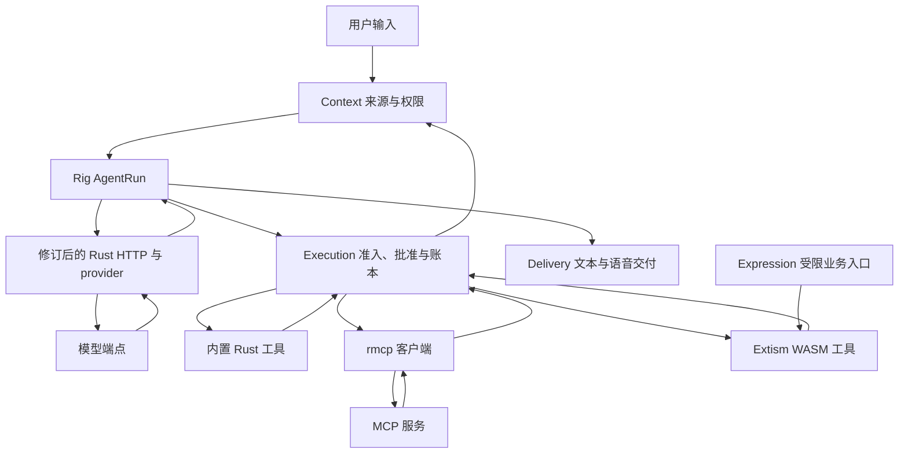

# Alia 纯 Rust Harness 调研与改造方案

日期：2026-10-18。用户已授权按本方案实施干净重构，并恢复 fetch 修复；真实模型验证继续暂缓。

## 实施状态

Rig fork 已建立在 [Ke-Qiao/rig 的 codex/alia-harness 分支](https://github.com/Ke-Qiao/rig/tree/codex/alia-harness)，Alia 固定使用提交 `c2ff3e30e6b8d84fc6759eab030656a42cae14ca`，临时 Rig vendor 副本已删除。补丁与独立测试记录见 fork 内的 [ALIA_PATCHES.md](https://github.com/Ke-Qiao/rig/blob/c2ff3e30e6b8d84fc6759eab030656a42cae14ca/ALIA_PATCHES.md) 和 [ALIA_TEST_RESULTS.md](https://github.com/Ke-Qiao/rig/blob/c2ff3e30e6b8d84fc6759eab030656a42cae14ca/ALIA_TEST_RESULTS.md)。依赖以 Cargo.lock 和根目录 Cargo.toml 的固定 revision 为准。当前改造覆盖：

- 模型服务与所有调用者迁到 Rig 原生消息、completion 和 AgentRun。删除原三套 provider 协议栈、旧 LLM trait，以及伪函数/文本工具调用回退；Context、Execution 和 Delivery 继续承担业务来源、批准、账本与交付。
- Rust 工具使用一个参数 DTO 生成 Schema；动态 MCP/WASM Schema 经本地有界校验后注册。工具结果仍经 Execution 保存收据，未知结果不会自动重试。
- MCP client 接入 stdio 与 Streamable HTTP，按配置用户隔离目录，目录变化触发实现身份变更；关闭自动重放，限制协议输入和生命周期。配置、API 和能力边界见 [MCP 工具服务](../operations/mcp-tools.md)。
- Extism 接入 Server 工具、表达插件与 Embedded processor。默认未激活，按精确内容 pin 授予；每次调用隔离实例，撤权/卸载先关闭准入并保留在途 owner。安装与使用见 [WASM 插件运维](../operations/wasm-plugins.md)。
- fetch 对每一跳检查并固定 DNS 地址，保留原域名的 Host/TLS 校验，关闭环境代理和自动重试；限制下载与转换，HTML 由 Rust 库转为 Markdown，返回内容标为不可信来源。
- 开发与验证工具链固定 Rust 1.96.0。新增能力使用 Rust 宿主与 Rust PDK；项目原有音频/推理的 native 依赖仍存在，并不代表整个依赖树仅含 Rust。

当前验证入口和完成结果统一记录在 [软件发布资料](../operations/software-release.md)。本页后续章节保留实施前的固定源码研究与决策依据；其中“建议”“下一轮”及版本环境描述是研究时点快照，不替代当前实现和动态验证结果。

## 1. 总体结论

采用 **Rig fork + 单一 Rust 工具定义 + 官方 rmcp + Extism Rust host/PDK** 作为下一轮实施方向。Rig 的缺口在其协议/运行时内部解决；现有 provider、通用 loop 和重复工具定义同步退役。无需保留旧框架来迁就第三方 API。

详细研究分为三份：

- [Rig 集成与 fork 修改设计](rig-integration-research-2026-10-18.md)：发布源码、模型与循环、流式处理、版本与修改范围。
- [工具构建与 MCP](tools-mcp-research-2026-10-18.md)：参数类型、Schema、统一执行入口、rmcp 接入和桥接选择。
- [Extism 集成](extism-integration-research-2026-10-18.md)：WASM 产物、宿主函数、资源/取消、安装与生命周期。

纯 Rust 的实施目标是：模型与工具宿主、MCP 客户端和插件宿主使用 Rust，项目示例插件用 Rust PDK 编译为 WASM，不为本轮能力增加 JS/Python 运行服务。Rig 运行在宿主中，Extism 运行插件，两者不是把 agent 塞进 WASI 的关系。

图中的 Context、Execution、Delivery 表示 Alia 的业务责任，其接口和实现都可重构。来源、批准、幂等、执行不确定状态和输出身份应有明确归属；库里的 session、approval、cancel 名称不自动提供这些行为。

## 2. 固定版本与依赖决策

| 组件 | 研究基线 | 采用方式和修改点 |
| --- | --- | --- |
| Rig | `rig-core` / `rig-agent` / `rig-http` / `rig-reqwest` 0.44.0，MIT | 从确切发布源码维护 fork；协议解析修改放回对应 crate |
| 工具 Schema | schemars 1.2.3、jsonschema 0.59.0，MIT | 单一 DTO 生成 Schema；动态 Schema 编译校验；禁自动外部引用 |
| MCP | rmcp 3.5.1，manifest 标注 Apache-2.0 | 使用官方 client/transport；执行及目录适配接 Alia；保留源码许可过渡说明 |
| Rig MCP 桥 | rig-rmcp 0.44.0 | 当前依赖 rmcp 2；不能当作 rmcp 3.5.1 的即插即用桥 |
| WASM 插件 | Extism 1.41.0，BSD-3-Clause；Wasmtime 49 | 使用 Rust SDK/PDK；按固定 feature 与权限构造实例 |

Rig 基线发布于 2026-10-07，源码提交为 `2d1071e0e0c602f994e9d6cfd8cf5faea6f53650`。发布包要求 Rust 1.95.0；Extism 的 Wasmtime 49 依赖要求 Rust ≥1.96。本机当前 1.95.0，因此 Extism 落地需要统一升级开发/CI/发布工具链，而不是只改一个 Cargo.toml。新拆分的 Rig API 还很新，fork 的测试与维护由项目承担。[Rig 发布包](https://crates.io/crates/rig-agent/0.44.0)、[Extism 固定依赖](https://raw.githubusercontent.com/extism/extism/051b765/runtime/Cargo.toml)、[Wasmtime 版本要求](https://docs.rs/crate/wasmtime/latest/source/Cargo.toml)

不引入 `rig-harness` 占位 crate。Rig 的 agent、HTTP 和 provider 包应从同一固定基线解析，不混用 Git main 和发布文档。[占位说明](https://docs.rs/rig-harness/latest/rig_harness/)

当前 Alia 使用 reqwest 0.12，Rig 的标准 transport 使用 0.13，rmcp 3.5.1 使用 ^0.13.2。建议统一迁到经锁定和验证的 0.13 patch 版本，并复用同一种有界读取政策。STT、TTS、embedding、Home Assistant 和其他现有 HTTP 调用也是工作区升级的影响范围，必须一起验证；仅向库传入一个 reqwest Client 并不能修复库内部的整读响应。[rmcp 固定依赖](https://raw.githubusercontent.com/modelcontextprotocol/rust-sdk/rmcp-v3.5.1/crates/rmcp/Cargo.toml)

rmcp 固定源码的 LICENSE 仍记录 MIT 向 Apache-2.0 迁移，部分贡献保持 MIT。分发时应保留实际源码的许可与 notice，不能仅复制 Cargo 的单行标签。[许可说明](https://raw.githubusercontent.com/modelcontextprotocol/rust-sdk/rmcp-v3.5.1/LICENSE)

## 3. Rig fork 的职责

建议把改动分成三类，均可作实质修改：

| 类别 | 具体工作 | 完成标准 |
| --- | --- | --- |
| 通用协议正确性 | 读取中限制普通/错误响应；严格 UTF-8；限制 SSE 行/事件/累计数据；规范 provider 终止判定 | 异常流被拒绝，不产生成功完成或可执行的残缺工具调用 |
| agent 执行契约 | 由宿主驱动模型/工具步骤；受控恢复和重试；完整保留 provider 连续性字段 | 来源每轮复验；工具 dispatch 后仍由原 owner 收口；恢复不重放副作用 |
| Alia 产品接入 | profile 与设置生命周期、Context/Memory 扩展、执行账本、语音交付 | 所有模型使用方迁移，取消和权限行为不退化 |

前两类修改应尽量放进 fork 的对应 crate，并带协议 fixture。Alia 的业务 SQL、权限政策和设备交付不塞入 Rig 通用 crate。允许扩大 fork 改动范围，也应能说明每个改动解决的行为，以及未来升级时的验证位置。

建议保留一条固定源码的 fork 集成路径，使用固定 revision 或受版本控制的 vendor 源码；所有改动 crate 通过 Cargo patch 统一。执行时记录原始 revision、许可证和补丁说明，检查最终依赖树没有误用未修订的同名 crate。研究阶段没有创建远端 fork 或更改依赖；后续实施状态见页首。

## 4. Alia 完整迁移范围

源码核查发现，替换范围明显超过三个 provider 文件和主工具循环。

| 范围 | 当前位置（相对 `packages/alia-server/src/`） | 迁移要求 |
| --- | --- | --- |
| Provider 与通用消息 | `providers/llm/`、`providers/adapter.rs` | 删除 SDK 已承担的 DTO/协议转换/聚合；模型运行时采用 Rig 类型 |
| 装配、profile 与生命周期 | `bootstrap/{factory,builder,registry}.rs`、`config.rs`、settings | 同一配置实例服务多个角色时只初始化和清理一次；保留 endpoint/model 配置隔离 |
| 主对话与语音 | `modules/interaction/{generation,llm,tools,streaming,services}.rs` | 普通循环改为 AgentRun；流式文本、句子表达和 TTS 仍接 Delivery |
| 辅助推理 | routing、cache review、memory capture/maintenance、companion、insights、`api/voice.rs` | 同步迁移；不能只让主对话使用 Rig，后台继续走旧模型栈 |
| 上下文与持久化 | memory/context、conversation、persistence、response、debug | 分清运行历史、用户可见历史和来源证据，不把原始 SDK 数据无差别写入日志或数据库 |
| 工具 | `tools/`、`plugins/home_assistant.rs`、`modules/execution/` | 单一参数定义、统一执行准入、稳定实现身份，动态目录变更可使批准失效 |
| 工具管理 API 与界面 | `api/tools.rs`、`entity/tool.rs`；前端 `lib/api/{types,hooks}.ts` 和 tools 页面 | 更新目录 DTO/展示、参数校验说明与手动调用；旧 OpenAI 格式导出需明确保留兼容还是版本化退役 |
| 插件 | `expression/`、plugin 管理、Embedded 适用入口 | WASM 执行机制替换原对应子进程路径；安装、授予、实例和业务执行分别标识 |
| 验证与说明 | provider fixtures、interaction/execution/runtime 测试、`scripts/check-server-boundaries.py`、配置示例 | 更新调用者、测试替身和边界检查；删除失效旧导出和配置 |

当前 `ChatMessage` 既用于模型输入，也用于会话/Context 的文本映射，而数据库 `chat_messages` 只保存角色和文本。建议在模型运行时直接采用 Rig 完整消息；持久业务记录继续按实际用途保存规范字段。转换发生在 Context/Conversation 边界，不能为了接口统一就把 reasoning、signature、原始工具载荷一并公开给用户或写进普通 trace。若新增 run checkpoint，必须有版本、来源绑定和受限可见性，不能直接把 SDK 序列化格式当作长期稳定数据库契约。

旧 `alia.tool_calls.v1` 和 pseudo-function 文本解析建议正式退役：需要工具的 profile 明确要求原生 tool calling；纯文本模型仍可承担无工具任务。这是待实施的能力契约变化，应更新配置验证和 fixtures，不以解析任意模型文字来弥补能力缺失。

## 5. 工具与 MCP 的集成原则

一个工具只维护一份参数契约；Rust 工具用 DTO/Schema 派生，动态 MCP/WASM 工具使用已登记的 Schema。不要为同一工具分别维护 Rig 宏、rmcp 宏和手写 JSON 三份定义。

模型只接触工具名、说明和参数 Schema。业务上下文由宿主提供：用户、Context、隐私 epoch、实现 revision、deadline、取消与凭据不成为模型可伪造的参数。Rig 的可序列化 ToolContext 也不是存放 live 句柄或密钥的容器。

MCP 接入先完成 client。对外把 Alia 发布成 MCP server 是另一项产品能力，当前无需为了工具复用增加。是否升级 rig-rmcp 桥或直接使用 rmcp，以能否统一执行准入、工具目录变化和多模态结果为判断标准；仅修改依赖版本不足以完成集成。

rmcp 3.5.1 的默认策略需要审核并调整：会话失效后的重发、目录出错时返回旧缓存、stdio/HTTP 读取上限，均会影响 Execution 的结果判断。重连可以恢复通信，但不能借此重放状态未知的副作用。详细事实、接口和验收见[工具/MCP 专项](tools-mcp-research-2026-10-18.md)。

## 6. Extism 的实施边界

首轮 Rust PDK 示例采用无 WASI 的 WASM 产物，宿主只从已验证的模块字节加载。能力经窄 host functions 开放；持久状态经 scoped storage 管理，宿主凭据不交给 guest。插件给出的 manifest 只表达请求，由 Alia 生成实际有效运行配置。

表达/Appraisal 与工具插件可共用 Extism 执行设施，但业务输入、输出和权限分开校验。未审核代码安装后保持未激活；启用、升级、撤权及清理状态与既有插件契约对齐。受信 native 模式若仍需支持，继续是显式部署选择，不作为 WASM 失败后的回退。

首轮不预建通用实例池。建议每次调用使用独立 Engine/CompiledPlugin/Plugin，配低并发和宿主可信编译缓存，避免 guest 状态跨调用遗留和共享 epoch 取消串扰。额外编译成本需要测量，不能假定缓存后等同于复用实例。固定源码的 timer Stop 无确认屏障；仅串行复用 Engine 也不足以证明旧取消不会影响下次调用。若之后要复用 Engine，需要先修复或证明取消屏障，再恢复共享编译实例。初始化阶段、阻塞 host callback 和缓存信任也有明确约束。详见[Extism 专项](extism-integration-research-2026-10-18.md)。

## 7. 建议实施顺序与验收

前置步骤：固定开发、CI、发布的 Rust 工具链及目标平台；采用本报告 Extism 基线时先升级至满足 Rust ≥1.96 的已选版本，再执行依赖编译。同步固定 fork 和 HTTP 版本。

1. **建立 fork 基线和协议 fixtures。** 修复有界读取、解码及终态；明确每种 provider 的兼容契约。纯本地模型服务 fixture 即可执行。
2. **迁移完整模型闭环和所有辅助调用者。** Rig 接管普通 loop、消息与工具回合；Context、Execution、Delivery 接入；删除对应旧模型栈。
3. **统一工具构建。** 转换一个纯函数工具与一个有副作用工具，验证参数、Schema、身份和批准，再迁移其余内置工具。
4. **接入 rmcp。** 采用一个本地 Rust fixture server，覆盖目录更新、会话过期、取消、断连、任务结果和大响应，确认副作用不被透明重发。
5. **接入 Extism。** Rust PDK 示例覆盖安装→授权→调用→升级→撤销→卸载；验证越权访问、无限循环、初始化、超量输出、取消和残留状态。
6. **发布检查。** Mac/ARM64 Linux 目标、功能裁剪和依赖树；通过后才声明可替代。真实模型、性能与硬件验收单独记录，不伪装成本地 fixture 结论。

每阶段的完成应包含旧实现删除和调用者迁移。源码可编译、协议可运行、业务权限正确和平台实测是不同证据。

以上研究阶段没有更改应用实现/Cargo 依赖，也未运行真实模型或硬件。后续已授权的软件实施与验证见页首；真实模型和硬件仍未纳入本轮。
