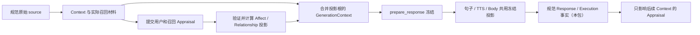

# Appraisal / Relationship 来源与撤销实施契约

状态：2026-09-20，**Appraisal 主体源码与定向回归已冻结，尚未合并或提交本包**。本文件的原设计从当前子任务成功写入记录恢复；Appraisal owned 的 31 个源文件/测试也按成功操作顺序恢复，重建测试与存活文件逐字节一致。恢复后的验证重新执行，不把中断前的结果当成本次验收，也不把定向通过替代后续完整 workspace 和固定提交平台验收。

当前已接入规范用户来源与实际召回、持久政策、独立 relationship epoch、Appraisal 记录与不可变投影、Memory 父 revision 与关系来源闭包、Pipeline 冻结前投影、ResponseCommitted 及实际终态 Execution 的事实。旧 AffectStore、旧 RAM profile、旧数据库 writer/ORM 写入、句子全局 cache 与私人 Expression trace 内容已退出生产路径。后文“原入口”表记录改动动机；不表示这些旁路仍在运行。

本包保留纯表达规划与受监督 writer 的可复用实现。**Delivery/Text/Body 派生 Appraisal、Companion 主动行为、前端和 Embedded 通用适配未实现，留待后续轮次**。音频 Submitted/Completed、Body Submitted 均不在本包推导为“用户听到”或“身体到位”。Memory embedding 身份迁移在独立主包中实施；整合时必须保留本包的父 revision 与 Appraisal 根校验，并接到新向量实现的 provider 前后两个 gate。

原始消息根现在使用独立的 `memory_message_sources` 固定身份、原 stamp 与正文摘要；读取不能拿当前被编辑后的消息重新补证，Relationship clear 也不能因此误删独立 Memory。派生 Memory 的父 revision/private/expiry 校验同时覆盖 Context、standalone 检索、图谱和旧向量投影两个 gate。`graph_for_user` 使用持久 graph depth、总候选预算和逐边校验；被撤销的边不能用来继续遍历。

同一 Appraisal 记录中长短事件分别失效：记录保留到最后一个合法事件的期限，投影以实际选中事件的最早期限为上界。旧投影到期后必须重新物化。未知 ACK 通过原 `AppraisalInput` 查询规范回执，查询不刷新时间、关系 epoch 或原权限。浮点负零在规范摘要中与正零采用相同表示，保留严格的 SQL 回读摘要核验。

恢复后的本子包定向验收全部使用默认特性，2026-09-20 共 175 项通过；其中涉及持久权限和生命周期的目标连接任务数据库 `127.0.0.1:32768`，每项使用独立随机 schema。默认 `cargo check -p alia-server --all-targets --locked --offline` 退出 0，无编译警告；`git diff --check` 通过。日志位于主工作目录的 `run/recovery-20260920/`：

| 范围 | 实际结果 | 日志 |
| --- | --- | --- |
| Appraisal 来源、SQL/政策回读、TTL、回执、父根与图谱 | 13/13，2.65 秒 | `appraisal-memory-context-final.log` |
| ContextLease | 23/23，2.63 秒 | 同上 |
| Memory | 13/13，0.47 秒 | 同上 |
| MemoryPrivacy | 24/24，4.01 秒 | 同上 |
| Pipeline 全模块 | 47/47，6.77 秒 | `pipeline-appraisal-full-final.log` |
| Expression writer 的实际 PG 锁、未知 ACK、clear 与关闭生命周期 | 7/7，7.73 秒 | `expression-runtime-final.log` |
| Memory capture | 6/6，1.07 秒 | `memory-capture-final.log` |
| Expression 纯测试与评估 | 35/35、7/7 | `expression-unit-final.log`、`expression-eval-final.log` |
| 默认所有目标编译 | 退出 0 | `appraisal-owned-check-final.log` |

最终整合仍需验证新版向量实现保留上述 gate；`consolidate_user` 的 PG promotion/dedup 新结果是否仍可通过父根闭包检索，尚未由本子包证明，交由主分支整合补测，不能用既有 in-memory consolidation 测试代替。原始消息固定摘要的独立 3 项回归、重建/API/Ingress 子包与完整 workspace 的最终证据由主验收汇总。

## 1. 原入口与对应替换契约

下表路径相对于 `packages/alia-server/src/`，行号为本次审查定位；实现时以函数名确认，不依赖行号不变。

| 当前入口 | 实际问题 | 本包要求 |
| --- | --- | --- |
| `channels/pipeline.rs:2442`，`observe_user_affect_for_turn` | `AffectUserInput` 只有 channel/user/text；未传原始消息、lease、epoch 或政策。调用方不处理 `persistence_error`。 | 改用从规范 source 建立的 AppraisalInput；结果明确区分未接纳、已提交和提交未知。 |
| `channels/pipeline.rs:2563`，`plan_expression_for_response`；`expression/runtime.rs:167`，`observe_memory_recall` | 实际 MemoryPack 被转成裸 recall events。Runtime 接受调用方 hint，每次创建新 UUID 和当前时间，无 memory revision、原根集或 occurrence 去重。 | 只使用 Context 已物化且实际读过的召回材料；不能重新 retrieve，也不能把模型给出的 memory ID 当作证明。 |
| `expression/affect.rs:633`，`AppraisalEvent`；`entity/expression_appraisal_event.rs` | 持久记录没有规范 owner、source、Context、解释器版本；`evidence.summary` 只是文字。 | 建立有版本的规范来源与解释记录，禁止为旧无来源数据补造证明。 |
| `expression/affect/persistence.rs:79`；`expression/affect.rs:270`，`apply_appraisals` | advisory lock 只排序 SQL；writer 捕获启动时 AffectPolicy。RAM 在排队后、提交前更新。 | 在提交事务内校验原始权限；确认提交后才发布投影。 |
| `expression/affect.rs:126`，`clear_relationship_data`；`:1521`，`delete_persisted_relationship_appraisals` | Clear 只排序本实例已接纳任务，SQL 只删除 User/Relationship scope；尚未接纳的旧解释结果和其他实例没有 fence。 | 持久 relationship epoch 与来源 stamp；删除和失效按派生根处理，不以 scope 作为隐私边界。 |
| `expression/affect.rs:370`，`build_relationship_profile`；`:496`，`restore_appraisals` | preferences 克隆旧 map，只增添新 summary；恢复事件不重建同一份 profile。TTL 过滤不能核实来源。 | 从当前有效事件集合纯计算完整 profile；GET、规划和恢复共用该投影。 |
| `expression/runtime.rs:732`，`affect_snapshot_with_route`；`expression/extension.rs:227/279` | 每次读取重新执行 reducer；插件可给出任意 scope/source，外部 reducer 可替换整个 snapshot。 | 解释器产出有界 draft；服务器确定来源和允许作用域。规划使用冻结投影，重放不调用插件。 |
| `channels/pipeline.rs:2332/2361/2397`；`pipeline/delivery.rs::prepare_response` | Context 已冻结，之后才观察 assistant 与 recall；生成文本、route、used_tools 不能证明完成事实。 | 用户/召回投影在冻结前进入 Context；响应提交判断在规范事实之后生成，仅影响后续 Context；工具终态发生在冻结前时可在本轮同一锁内纳入，冻结后不得扩展旧响应。 |
| `channels/pipeline/streaming.rs:41/765/787` | `SENTENCE_EXPRESSION_CACHE` 是 512 项全局缓存，无 owner、epoch、Context、TTL、完整政策或解释器身份；key 含原句且遗漏 reviewer 的部分实际输入。 | 删除静态缓存和 get/put/key 路径。本包不另建 Expression 缓存。 |
| `channels/pipeline.rs:2587`；`pipeline/streaming.rs:834`；`providers/conversation/database.rs:324` | trace 持久复制 recall content、原句和自由文本判断，没有原 Context gate。 | 改为受约束的来源引用和结构化结果摘要；撤权后禁止新的私人派生 trace。 |
| `providers/memory/privacy.rs:153`；`api/expression.rs` | Memory clear 未覆盖上述派生数据；Relationship GET/clear/prune 使用 RAM profile 和启动政策。 | 事务撤销传播、跨实例规范读取、持久 clear/prune，不能只清本地 map。 |

`ContextPolicy.appraisal` 已包含 Affect、词典、解释器/reducer 版本与批准的实现 pin。旧数据库政策形状必须先验证旧摘要，再只补新 Appraisal seed 并递增 version；重复启动以数据库为准。仅增加 `context_id` 而继续使用启动时 AffectPolicy 不满足契约。

## 2. 区分来源、事实与解释

规范来源由服务器从 SQL 和实际物化读集建立，不接收模型 JSON 作为来源证明。已持久化的 Appraisal 证明“某解释器产生过这份判断”，不证明判断内容为真，也不自动成为可写入 Memory 的用户事实。

| 类别 | 合法依据 | 不足以构成依据的输入 |
| --- | --- | --- |
| 用户观察 | 原始已提交用户消息的 owner、session、source ID、原时间、privacy/relationship epoch 和正文 digest | 任意 user_id/text、模型总结、把 STT corrected text 当作新用户消息 |
| STT 派生解释 | 同一原始消息下、输入输出摘要与解释器版本明确的规范转换记录；保留完整父根 | 重新分配 source ID 或用修正完成时间刷新原 source |
| 召回 occurrence | 当前真实 request 下的一次规范物化；实际采用的 memory ID/revision、片段摘要、查询/过滤身份及完整根 | `MemoryRecallEvent` 中自报的 ID、hint、confidence，或另一次独立 retrieve 的结果 |
| Response 事实 | SQL 核实的 committed Response、精确 final content digest 和原 Context | 只调用过 prepare、生成了文本、Pipeline 记录了 turn_completed |
| 输出/工具事实 | 原 Delivery/Text/Body/Execution 的准确身份、规范阶段和不可变事实摘要 | `used_tools=true`、无异常返回、Submitted 推断为用户听到或身体到位 |
| Appraisal | 以上输入、解释器及配置版本、结果摘要、置信度、有效期和 supersession/撤销状态 | 把 kind/source 标签、自由文本 explanation 或关系分数当作权限 |

原事实的登记与新派生权限分开：撤权后已经发生的 Delivery/Execution 晚事实仍按原账本契约入账；**从该事实生成新 Appraisal 仍需当前权限验证**。不能借“记录事实”重新取得表达、Cache、Memory 或执行许可。

判断理由优先采用有界 reason code 和规范引用，不把原消息、Memory 片段或自由文本偏好复制进长期 evidence、dominant causes 或 trace。确需保留的派生文字必须有同一根集、明确用途与删除规则，不能落入普通无来源 JSON 字段。显式安静、隐私、音量及设备安全约束保持硬 gate，关系或情绪分数不能放宽它们。

## 3. 持久政策与独立 relationship epoch

将实际 Affect/Relationship 政策纳入现有持久政策发布机制，包括启用、允许来源和作用域、是否保存偏好/证据、TTL/衰减、阈值、投影容量、基线及 reducer 配置。解释器身份另外记录实现/提示/模型请求描述与配置版本；无法证明的远端模型权重版本不得冒充已知版本。启动配置只 seed 尚不存在的政策，不能覆盖 DB；政策 CAS 确认后才发布 RAM 投影。

在 owner 下建立独立单调 `relationship_epoch`，所有用户来源的情绪和关系派生都受它约束，包括 Session/Turn 事件；不能通过改 scope 逃过清除。Memory 的隐私边界继续用现有 `privacy_epoch`。Appraisal admission 同时核对两者及实际政策版本。

关键约束是 **在原始输入接纳事务中同时取得 privacy 与 relationship 两个 stamp**，由 `capture_source_epochs` 和 clear 使用一致锁顺序。排队、STT、上传和原消息落库都保存这两个原值；即使清除或停用发生在中途，已真实接纳的原文仍可落库展示，不能在迟到保存时刷新 stamp。当前 epoch 的许可比较发生在 Context/Appraisal/派生写入 gate。原消息缺少 `source_relationship_epoch` 时不补造证明。后到的 STT 修正、Response/Execution completion 和重试同样不改签。

Relationship clear 的事务必须：

1. 校验当前 active actor 与持久 clear 政策，锁既有 privacy 行和 relationship 权限行。
2. 推进 relationship epoch，即使当前没有事件或投影也推进；清除不以本机队列是否为空作为条件。
3. 删除该 owner 的关系/情绪派生正文，失效投影及依赖旧关系根的派生数据；审计只保留必要的身份、原因、阶段和数量。
4. 提交后发布失效通知和本机投影变化；API 只有确认提交才报告成功。超时/丢 ACK 保留原操作身份与未知状态。

Relationship clear 保留独立的规范 Memory 和会话展示，不自动扫描旧材料恢复关系。之后真实新 source 可以按当前政策使用仍合法的 Memory，并形成新的召回 occurrence；这不等于给旧解释任务补新 epoch。以旧 Appraisal/关系投影为来源的 Memory、Cache 或派生历史，必须因根失效而不可再用于模型，不能借保留 Memory 重新引入旧关系。

Memory clear/forget/revision 变化按既有隐私契约处理，并使依赖这些根的 Appraisal 和投影失效。Memory clear 不能只清 Memory 表而保留关系、trace 中的私人副本。通知用于加快撤销，不能承担权限正确性；跨实例每次读取/提交仍检查 SQL。

## 4. 提交身份、事务与发布

目标 Appraisal 记录至少包含：

| 字段组 | 不变量 |
| --- | --- |
| 身份 | 规范 owner UUID、逻辑判断身份、事件/版本、原 request 和 occurrence；channel/session 只限定作用域，不替代 owner |
| 来源 | 原 ContextBinding、source ID/时间、privacy/relationship stamp、实际材料 digest、完整规范根与直接事实引用 |
| 解释 | interpreter ID/version、解释政策摘要、输入 digest、不可变结果 digest、有限且有界的 confidence/deltas、reason codes |
| 生命周期 | 明确 effective_at/valid_until、supersedes/撤销状态、提交结果；处理时间与来源时间分开 |

逻辑判断身份绑定 owner、source occurrence、判断种类和解释器身份。相同解释器版本及相同输入的重试复用原结果；同一提交身份改意图返回冲突。解释器升级或反馈修订产生显式新 revision，并 supersede 原判断，不能让新旧版本在投影中双重计权。用户反馈必须来自它自己的规范 source，不能直接修改旧判断的来源或结果。

一次真实新召回可以拥有本次 request 的 occurrence 时间，但保留所用 Memory 的原始来源与 revision；重复同一物化、网络重试和重建不得重新开始 TTL。`valid_until` 不晚于自身 TTL 和所有依赖的最早到期时间。

保留当前单 writer、128 批容量、关闭接纳、drain/join 和已接纳操作 ownership。扩展队列命令使其携带原 AppraisalInput 与每次提交 ACK；模型/插件等待在事务外完成。写入步骤为：

1. 在短事务中，按政策 → active owner → 既有 privacy 行 → relationship 行 → 稳定排序的规范证据 → 对应 Appraisal/投影行取锁。更新其他相关表的入口也使用这个顺序。
2. 核对原 lease 的适用用途、两个 epoch、source stamp、当前政策、事实状态、完整根、输入 digest 和原有提交身份。
3. 已有同意图记录返回原结果；若已被撤销，查询可以如实报告历史提交状态，但不能返回可用于当前规划的有效投影。
4. 原子提交判断及其 revision/supersession。提交确认后才发布可用投影；发生明确失败不能留下 RAM delta。

提交 ACK 未知时按原身份查询，不能换 UUID 自动重试。未知结果不作为已确认个性化输入；查询发现已提交后仍需当前来源校验才可使用。排队、校验与持久结果的错误不得继续通过 `AffectObservation.persistence_error=None` 或裸 snapshot 隐藏。

无 DB 的模式只能是显式隔离的纯规划/测试构造，不能作为生产 observe、Relationship API 或个性化规划的隐式成功回退。数据库不可用时不能使用旧 RAM 关系值伪装成功；如当前 Context 仍可合法建立，可显式选用不含私人材料的基线投影，否则返回错误并遵循已有受限提示规则。

## 5. 冻结前投影与冻结后 completion

目标顺序为：

初始用户/召回判断在首个输出准备之前完成并纳入 Context。工具带来新的规范读集时，可以在同一 turn 的 context 锁内扩展，并保留此前实际使用的全部根。输出准备开始后，即使数据库 ACK 未知，也不得追加 appraisal、换 policy 或重建一个新 lease 继续原响应。

目标接口职责如下，名称可在实现中统一，但不能合并掉权限边界：

| 目标接口 | 输入与结果约束 |
| --- | --- |
| `prepare_appraisal_input` | 输入真实 GenerationContext 和服务器选择的规范 occurrence/事实身份；返回封装的实际材料、原 Binding、两个 epoch、版本与 digest。插件不能自行构造有效实例。 |
| `commit_appraisals` | 仅接受上述原输入及有界 draft；提交事务重复核实来源，返回原提交身份和明确结果。 |
| `extend_affect` | 从 SQL 有效判断计算不可变投影，向原 GenerationContext 合并直接 Appraisal/投影引用及完整根；不刷新 source/policy，不允许冻结后调用。 |
| `plan_with_context` / sentence planning | 接收相同冻结投影与实际 MemoryPack，不能内部再读用户/global RAM 或重新 retrieve。 |
| `observe_committed_fact` | 从规范 Response/Delivery/Execution ID 重读实际事实，继承原 Context/source；产生的判断不回写产生该事实的 Context。 |
| `relationship_profile_for_actor` | 当前 active actor 的只读规范投影；不能凭这次 API 读取制造 Generation source 或授权输出。 |
| `clear_relationship` / 有界维护 | 原操作身份、当前 actor、持久 epoch 与明确 ACK；查询/维护不隐式获得模型生成或其他副作用许可。 |

Context 增加适用的 Appraisal 写入、投影读取和维护用途，并增加 SQL 核实的 Appraisal/投影证据。SourceNotice 仍只允许固定提示 OutputAdmission，不能借它解释用户、读关系、写偏好或执行 Body。维护如需专用 lease，只授予对应重建用途，不能制造虚构用户消息。

投影必须携带事件 ID/revision、两个 epoch、政策和 reducer 版本、显式 as_of、结果 digest、实际根与最早到期时间。空投影也保留对应权限 stamp，避免“没有旧事件”成为在途任务跨 clear 的例外。把投影引用加入 Context 时同时检查父根完整性和循环；不能只存一个 projection UUID。

`ExpressionRuntime::plan`、`speech_for_expression_input`、`build_sentence_speech_context` 以及 reviewer 后的重规划都使用同一投影。Reviewer 开始前和返回后核对原 Binding，输出 admission 继续由既有事务 gate 校验完整根。删掉 `SENTENCE_EXPRESSION_CACHE` 及相关测试对旧缓存的假设；如以后有性能证据需要缓存，应单独设计为现有规范来源缓存的用途，不能恢复静态无根 map。

生成文本的临时语气分类可以作为本次规划的纯输入，但不能持久化为“回合已完成”。Committed Response、Submitted、确认呈现和 Unknown 分别产生相应事实，不能相互推断；assistant completion 的 Appraisal 只影响下一份 Context，避免 `Response → Appraisal → 自身 Context` 循环。已经进入模型或规划的旧投影必须完整保留在该次 Context 根集中，不能通过后来替换投影来删除已读材料的来源。

## 6. 有界重放、重建与派生失效

重放是 `reduce(valid_events, policy, reducer_version, as_of)`，不调用 LLM、插件网络、传感器或当前硬件。当前 `AffectState` 保存事件并由事件计算数值的形式可以复用；需统一事件筛选、稳定排序、完整 preferences 重建与数值校验。不得继续从旧 profile 复制 preferences，也不能由空的新事件集合刷新 profile 的来源有效期。

初始硬上限采用下表；实际持久政策可以收紧，不能取消。超限结果显式报告，不能留下正文却丢弃祖先凭据。

| 范围 | 上限与行为 |
| --- | --- |
| 输入与根 | 沿用 Context 总物化 128 KiB、证据 JSON 64 KiB、256 个引用；Appraisal/投影材料计入同一预算 |
| 单次解释结果 | 最多 64 个 draft，规范编码最多 64 KiB；字符串、浮点和数值范围逐字段验证，不先把无限结果收进队列 |
| 单次投影 | 最多 64 个有效判断，总量包含本次采用的 User/Session/Turn 判断；采用 SQL 确定的候选顺序，并以明确时间和稳定 ID 消除并列歧义 |
| 单次重建/清理候选 | 显式重建最多 32 条，清理最多 256 条，均按 owner 分页；不能启动时 `.all()` 读取全库。有效候选不足时返回这次明确选择的集合，不循环扫描全库补满 |
| 写入与清除 | 继续采用 128 批 writer 队列、2 秒提交确认上限；超时保留 ownership 和未知结果，不另起 writer |
| 解释等待 | 使用同一轮的总 deadline，持久政策可收紧，硬上限 10 秒；各插件不得分别重置整轮时限。取消/关闭保留已经接纳的持久任务责任 |

投影新增事件不等于撤销旧投影。一个响应已经使用的不可变事件集合，只要它的原来源仍有效，就不要求始终等于最新 profile head；事件被清除、supersede、撤权或到期则必须失效。缓存的 profile 只是性能投影，不能作为权限来源。

政策变化后拒绝旧在途写入，旧投影不可直接改签。重建必须从 SQL 已提交记录及其规范来源重新验证，并建立当前政策下的新投影证据：原 epoch、source 时间、判断时间和 valid_until 不变；旧解释器/解释政策不再允许的记录不能复用。仅在解释语义仍被当前政策允许、完整根仍准读时，才可复用已有判断计算新投影；这个受限重建不能接收未提交 draft。需要重新解释时，必须重新物化合法规范输入并显式产生 superseding revision，不在启动恢复或纯 replay 中调用模型。

显式重新解释已通过 `POST /api/v1/expression/relationship/rebuild` 接入。`000011_appraisal_rebuild` 持久化操作 ID、owner、原政策和双 epoch、游标、上限与固定来源列表；任务只引用已有规范用户判断的原始消息，不复制正文，也不自动重建 recall、Response 或 Execution。专用 `AppraisalRebuild` Context 只授予 Appraisal 写入和 Affect 读取，不能用于输出、Cache、Memory 或执行。每项 15 秒领取 token 允许崩溃后的接管；提交前再次核验原 token、Context、来源和过期上限，Appraisal 插入、旧判断 supersede 与任务回执在同一事务提交。重试复用原意图和已提交回执，不能补进新来源或刷新旧权限。HTTP 等待上限 2 秒；结果未知时返回原操作参数供核对。接口、分页与重试规则见[关系操作手册](../operations/relationship.md)。

2026-09-20 的工作树定向验证已通过：真实 PG 领取接管及事务故障 2 项；Runtime 关系相关 HTTP/清除 6 项，其中重建用例核验了固定来源页、过期上限、用途限制、未来投影采用及政策变化拒绝。证据保存在主仓库 `run/validation-20260920/body-server/rebuild-pg-tests.log` 和 `run/recovery-20260920/relationship-api-rebuild-current.log`。这些是定向验证，完整整合验收另记。

根集按实际已用材料去重并保留直接派生关联，不能生成无限父 Context 链。若某候选及其完整祖先超预算，整项跳过并记录结构化原因；已进入本次模型输入的候选不得再这样移除。后续总预算不足时，本次扩展失败，不能偷偷缩减旧根。

Relationship API、重启恢复、当前规划在相同规范事件集、政策和 as_of 下必须得到一致结果。Prune 的持久删除和投影失效也遵循同一门槛，不能仅删除 RAM 后等重启恢复。清除或到期后的基线不得带有旧 preferences、summary、dominant causes 或插件私有缓存。

trace 作为本包的派生出口处理：用户/召回 appraisal trace、句子 reviewer trace 和相关自由文本 debug 输出改为有界身份、阶段、版本和 reason code。普通 `Conversation.append_event` 不再接收这些私人派生 payload。需要展示解释细节时，应通过带 owner 和当前根校验的规范读取生成；清除后不能继续通过旧 conversation_events 读取副本。最小事实审计可以保留原身份和结果未知等状态，但不能保留被清除的私人正文。

## 7. 实施分包顺序与文件边界

实施在当前 Context 包固定提交之后的隔离 worktree 中进行。Memory embedding 包在主目录推进；先约定共用 Context、Memory privacy、migration 编号和 Builder 接线的修改归属，合并前重新验证，不能改写已经提交的 migration。

1. **来源、政策、存储。** 新 migration、Appraisal 实体/版本、owner relationship 权限行、规范 source stamp、持久 Affect 政策、Context 新用途与证据。旧无来源 Appraisal/投影明确清理或排除，不迁成合法记录。为 submit/clear/rebuild 建立同一事务边界。
2. **投影与 Runtime。** 改造现有 writer 的 ACK 和提交后发布；纯 reducer 和规范 profile；更换 observe/plan API；约束插件 draft，移除每次读取执行外部 reducer 的路径。保留既有 writer 生命周期和 Expression 编排所有权。
3. **Pipeline 与撤销传播。** 冻结前用户/recall 判断与投影扩展；冻结后规范 completion 观察；句子规划共用冻结数据；删除静态缓存；接入 Relationship API、Memory 清除和 trace。保留 `Conversation.commit_response` 已有幂等语义，不能重插用户已删除的派生历史。
4. **回归与证据。** 真实 PG 并发故障、纯重放和 Pipeline/输出用例完成后运行默认 Server 全目标检查与默认测试；集成到固定提交后再做 macOS/Linux ARM64 平台验收，逐条记录来源 SHA、命令、退出码和限制。

核心文件范围为 `expression/{affect,appraisal,runtime,extension,abi}` 及其内部模块、Appraisal 实体和新 migration、`modules/memory/context/**`、`providers/conversation/database.rs` 的原 source/trace 接口、Pipeline 的观察与 streaming 路径、Memory privacy 派生失效、`api/expression.rs`、必要 Builder/Settings 接线和对应测试。不得以保留兼容为由继续提供可触达生产个性化状态的 scope-free observe/snapshot；纯测试构造须显式区分。

本包不修改 Core/Embedded 的动作事实语义，不新建通用事件框架，不实现 Companion 的 Initiative/Opportunity，不恢复关系私有 prompt，不新增前端。Appraisal/Relationship 是待完成主线，不归入用户指定的前端/通用硬件适配延期。

## 8. 必须通过的回归与完成条件

PG 用例使用真实事务和可控屏障，至少覆盖以下不变量；纯算法断言不能替代 SQL 并发验证。

| 回归 | 必须验证的结果 |
| --- | --- |
| 原始身份与 STT | 错 owner/session、伪 source、正文变化、没有 relationship stamp 的旧 source 被拒绝；STT 修正保留原 source，两次回调不刷新 epoch/TTL |
| 迟到解释 | materialize 后、插件等待中、入队后、提交前分别执行 clear/policy/revision/expiry；旧判断不能进入有效投影或私人 trace |
| 两实例与丢通知 | A 解释旧输入，B clear；A 不接收通知仍不能写回。两个实例 GET/规划和重启后均不恢复旧关系 |
| 关系 epoch 的源头 | clear 前 source 在 clear 后第一次申请 appraisal 仍被拒绝；clear 后真实新 source 正常，不能把旧 source 更新成新 stamp |
| 双重清除 | Relationship clear 不删除独立 Memory，但依赖旧关系的派生材料不可再用；Memory clear/forget 使相关 Appraisal、profile、trace 副本失效/删除 |
| 幂等与未知 ACK | 并发同 occurrence、丢 ACK 后同身份查询/重试只应用一次，不续期；同身份不同意图冲突；撤销后的历史提交查询不授予当前使用权限 |
| 提交后发布 | SQL 拒绝/超时不能留下未经确认的 RAM 个性化变化；后续确认为 committed 也要再次验证当前权限 |
| 生命周期 | 保留 queue-full、关闭后拒绝、Clear 等待者 drop、提交未知、shutdown drain/join；超时不能释放原 writer 所有权或提前关闭其 pool |
| 纯重放 | 固定时钟下在线、恢复、重放和 API/规划一致；preferences 随证据到期/撤销消失；同时间排序稳定；256 候选/64 事件和字节边界真实生效 |
| 版本变化 | 政策/reducer/interpreter 变化拒绝旧 draft；合法重建保留原时间与完整根，不接纳未提交 draft，不累计 superseded revision，不在 replay 调模型 |
| 冻结与多轮工具 | 初始投影与实际召回根先于首个 prepare；MemorySearch 扩展保留旧根；冻结后不能追加、换投影或用新 lease 重试未知 prepare |
| 规范 completion | 未 committed Response、Pending 工具、失败或 Unknown 输出不产生完成判断；实际晚事实可入原账本，但撤权后不能派生新的 Appraisal |
| 插件与硬约束 | 伪 owner/source、Global/Device scope、NaN/Infinity、超量结果被拒绝；安静/隐私/音量/硬件约束不能由情绪和关系评分放宽 |
| 句子与审计 | 相同句子的跨 owner 或 clear 后请求不复用旧缓存；clear 后迟到 reviewer 不写私人 trace 或获得 TTS/Body admission；无原句全局 key 或 recall 正文审计副本 |
| 旧路径与新安装 | 新 schema、重复启动和后续迁移一致；旧无来源记录不可读、不可自动补证；生产不回退到 RAM-only observe 或裸 relationship snapshot |

完成条件是上述入口全部迁移且默认特性测试通过，不能只以新增 repository 的通过项替代整条 Pipeline 验收。测试证据明确区分本包新用例、既有生命周期回归、完整 workspace 和固定 SHA 平台结果；`--no-default-features` 只作补充，不能替代默认 Server 测试。未完成任何一条仍标记为未完成，不把它写成后续优化。

相关现行契约：[Context 与撤销](context-revocation-design.md)、[Expression 所有权与既有证据](expression-evidence.md)、[进度记录](progress.md)、[平台记录](platform-validation.md)。后两份由主验收更新；本包最终完成状态、固定提交与平台结果由主验收更新；本文件不代替完整默认特性验收。
