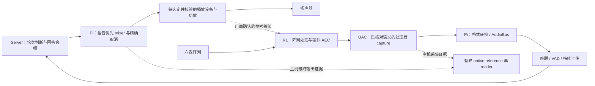

# R02 R1 硬件 AEC 参考路由与 consumer 前置核对

日期：2026-10-14；源码基线 `9890bab`，最近音频实现 `28920fb`。本轮只核对官方资料、现有实现与历史证据，不改变音频运行路径。进度见 [checklist](checklists/r02-r1-2026-10-14.md)，恢复见 [检查点](resume-checkpoint-r02-r1-2026-10-14.md)。R03 继续按用户要求暂停。

## 结论与决策状态

公开资料支持的候选是：R1 在设备内处理六麦输入，由独立功放参考口取得播放信号，再通过 UAC 向 Pi 输出处理后的单通道音频。**还没有本机设备、固件模式或声学效果证据，不能把产品能力声明当作已经消回声。** 六个麦克风不代表主机收到六个 PCM 声道。

用户已确认优先验证 R1 硬件 AEC，Pi 继续负责输出混音、格式转换、唤醒/VAD 和上传；只有确认该路线的兼容性、模式或实测效果不能满足目标时，再评估主机软件 AEC。此决定固定后续研发次序，本次仍不启用设备。软件 consumer 未选定，现有 reference reader 仍只是显式诊断/未来消费边界，不为未知 consumer 新建接口、feature 或 worker。

## 官方资料证据及边界

| 本轮核对来源 | 可支持的事实 | 仍不能推出 |
| --- | --- | --- |
| [R1 课程](https://www.yahboom.com/study/R1_6_MIC/)与[商品](https://www.yahboom.com/tbdetails/?id=694) | 课程 743 / 商品 694 对应 R1，不能借用别的六麦型号参数 | 用户实物与网页展示版本一致 |
| [公开模块介绍](https://www.yahboom.com/build.html?id=16444&cid=743) | UAC 向主机提供单通道降噪音频；另有功放信号参考口用于 AEC；更多资料指向资料包“附件 → 厂商资料” | USB playback endpoint、USB 内部参考、持续输出/唤醒门控、AEC 当前开启、原生采样率/位深 |
| [UAC 引脚图](https://admin.yahboom.com/public/upload/upload-html/1779334489/image-20260327194244523.png)及[参考引脚图](https://admin.yahboom.com/public/upload/upload-html/1779334489/image-20260327194301544.png) | UAC 电源/USB 数据与左、右功放输出正负端参考为不同接口 | 负端可接地、可用任意 line-out、单声道如何接、BTL/Class-D 兼容性、允许幅度/阻抗/共模与衰减要求 |
| [商品规格图](https://img.yahboom.com/images/store/PC/6M_2/pc%E7%AB%AF_19.jpg) | 提供机械尺寸图 | 音频格式、AEC 算法帧长/延迟、电气额定或用户实物板版本 |

动态网页的正文来自官方公开 API；本轮实际成功读取了 [课程数据](https://api.yahboom.com/api/product?cname=R1_6_MIC&from=study)、[无密码介绍数据](https://api.yahboom.com/api/build?id=16444&cid=743)及[商品数据](https://api.yahboom.com/api/purchase-detail?id=694)。直接网页解析仅显示导航，不能据此说“官方没有资料”。来源、时间、HTTP 状态、字节数和 SHA-256 见 [证据元数据](handoffs/2026-10-14-r02-r1/evidence/source-retrieval.json)；厂商正文/图片仅在 ignored `run/validation-20261014-r02-r1/` 留作核对，不整篇复制入仓库。

本轮没有下载资料包、访问受密码保护的课程、联系厂商或运行任何厂商程序。当前已读公开资料没有填齐表中未知项；不宣称整个资料包都没有这些参数。

## 硬件与主机处理分工

下面是依据公开接口提出的待确认链路，不是接线图或已部署状态。功放参考支路须有对应型号/版本的电气依据后才能接线。

| 所有者 | 当前职责与后续约束 |
| --- | --- |
| R1 固件 | 承担厂商声明的阵列/AEC 处理。须确认实际模式、参考来源、处理声道、无参考行为和重开/收敛规则；主机当前没有读取或设置这些状态的协议实现，不伪造 AEC 健康状态。 |
| Pi 播放 | 原 mixer 混合回答和短提示，保留输出身份、音量限制、精确暂停/取消及 native owner。硬件参考应覆盖最终实际发声的全部内容；主机 post-mix PCM 不包含尚未测量的 DAC/功放/扬声器影响。 |
| Pi 采集与 speech | 在确认输入确为所需处理信号后，沿现有转换与 AudioBus 到 wake/VAD/upload。不得把同一端点的 raw/reference 当作普通立体声音轨混入；设备内部唤醒门控如使持续 capture 不完整，须先解决模式兼容性。 |
| Server | 沿既有规范处理持续语音及 Easy-Turn 判断。Easy-Turn 的轮次标签不替代 AEC；模型仍在 Server，主机软件 AEC 也不自动迁到 Server。 |
| 诊断 reader | 显式独占读取有界 native 队列。硬件 AEC 自己消费物理参考，不要求另一个主机 AEC reader 常驻；取得 reader 不会改变 speech 输入。若将来确需软件 AEC，再指定唯一 owner 及其输出如何进入 speech。 |

当前 `alsa_playback_lock_to_capture_rate=false` 保持。两个设备在同一 Pi、名义采样率相同，或 R1 内部完成处理，都不能证明主机 capture/playback 共享时钟。硬件处理是否适配独立播放时钟也属于厂商资料和实测内容；现有主机时钟证据不直接描述 R1 内部算法时间线。

## 帧、声道与延迟契约

“帧”必须带所在边界。下表是当前代码事实及前置要求，未填写的物理值保持未知。

| 边界 | 当前事实 | 接入前要确认的要求 |
| --- | --- | --- |
| R1 UAC capture | 公开介绍为单通道处理输出；设备尚未接入核验 | 对应固件的 endpoint、稳定身份、实际 rate/位深/声道语义、连续输出或唤醒门控；不能直接填仓库默认值 |
| 主机 native input | CPAL 选择支持配置，ALSA 使用 near 协商；请求值不保证等于实际值 | 记录请求与最终协商值，选对 R1 PCM；如只有处理后 mono 可沿现有路径，如出现混合语义多声道则先固定处理端点或完成有依据的通道选择 |
| CaptureConverter | 当前对全部原生声道求平均，再转换为目标 rate/channels；`capture_channels=1` 不是“选择第一个处理声道” | 不能把未知多声道当作可平均输入；此为条件性接入门槛，尚未在 R1 上复现故障，本轮不猜通道编号来补代码 |
| speech | 连续会话要求转换后 16 kHz mono；每上传块最多 1600 样本（最多 100 ms），短尾不为组帧补零 | 这是传输约束，不是 R1 原生格式、固定 100 ms 等待或 AEC 帧长 |
| VAD / 后端 period | Silero 默认窗口 512；`opus_frame_ms` 当前用于 ALSA capture period 请求 | VAD 推理窗口、native buffer 和上传 PCM 各自有语义；名称不能证明当前链路为 20 ms Opus 或 AEC |
| native reference | 每块最多 1024 个交错样本，64 块由采播共用；实际声道帧数为样本数除以 channels | 不保证固定毫秒数或固定可承受等待时间；容量不是延迟预算，不足完整声道帧不能伪造补齐 |
| playback 转换 | 已有 rubato 固定比例转换，其内部块为 `input_rate/100`；没有漂移反馈控制 | 内部约 10 ms 块不是已选算法帧；转换滤波与排空尾部需计入将来的测量 |
| 未来软件 AEC（仅条件项） | 当前没有选定 processor、组帧 worker 或新依赖 | 选定后才固定支持 rate、capture/render 声道映射、帧长、调用顺序、尾帧、参考等待上界及 reset/重新收敛条件 |

源码定位及完整路径见 [host HANDOFF](handoffs/2026-10-14-r02-r1/host-HANDOFF.md)；已实现时钟、gap、replay 语义继续以 [时钟契约](audio-reference-clock-design.md)为准。

延迟必须按边界记录，不能直接把各软件时间戳相减当作声学时延：

- 输出：混音提交 → 后端/系统队列 → DAC/功放/扬声器实际发声；取消之后已排入硬件的尾音须另测。
- 输入：真实声学事件 → R1 阵列/硬件处理 → USB/后端 capture → 主机转换/缓冲 → VAD/上传 → Server 轮次判断。
- 硬件 AEC：参考进入设备与麦克风内部处理的对齐、支持延迟范围、无参考和重收敛时长；当前主机不可观测这些内部值。
- 软件证据：CPAL 后端估计、ALSA status/delay、host observation 和转换后游标保留各自语义；无跨流校准映射。clock/gap/reopen 可使映射失效，缺失 PCM 不补作真实静音。

本轮不设置猜测的 AEC 帧长、ppm 阈值或等待毫秒数。未来先固定允许的端到端目标及量测方法，再记录各段分布、失败分母与重开结果；单次 queue delay 和 Server 推理耗时均不能替代端到端测量。

## 用户确认与下一包入口

2026-10-14 集中问题已收到回复，已知状态如下：

1. **采用硬件 AEC 优先路线。** Pi 保留现有混音、格式转换、唤醒/VAD 和上传职责；当前不叠加主机软件 AEC。
2. R1 实物板号、固件和官方资料包“附件 → 厂商资料”仍未确定；扬声器/功放、参考电气与单/双声道接法、模式/延迟资料也仍未确定。
3. 用户说明 Pi 使用 SSH 连接。沿用既有 `ke-qiao@192.168.10.221` 的访问资料和既定只读核对边界；这不是 R1 已通过 USB 接入的确认。R1 上次明确状态为尚未接入，本次没有新的接入/枚举证据，也没有新执行 SSH。

在对应资料到达前：

- [ ] 固定实物/固件与厂商文档版本，核对 reference 额定、接法及可用模式；不凭网页照片或线色接线。
- [ ] R1 实际接入指定 Pi 后，在单独明确的只读核对包记录稳定 USB/ALSA 身份、描述符格式和账户访问条件；不用会打开 PCM 的能力/health 探测代替枚举。
- [ ] 确认实际输入只含所需处理音频；只有真实模式要求才实现通道选择并离线复现/验证，维持 API 和单 reader/owner 边界。
- [ ] 固定功放/扬声器参考路径、物理布局及运行模式；硬件消费正常与主机队列丢块分别记录，软件 evidence gap 不能自动诊断为硬件 AEC 失效。
- [ ] 后续单独确定真实录放音窗口、PCM 保存/删除规则、量测材料和通过条件，再验证双讲、暂停尾音、门控、重开与资源清理。R05 仍等待 R02/R03 的现场出口。

本轮不重跑历史 Cargo/CLI 测试。上一包 335/0/0（默认）与 260/0/0（无默认）只作为未改动源码的历史验证，当前验收是来源核验、实现静态审查、源码/依赖未变及文档一致性检查。R01—R06 仍 2/6；本前置包完成不表示 R02 声学验收完成。
