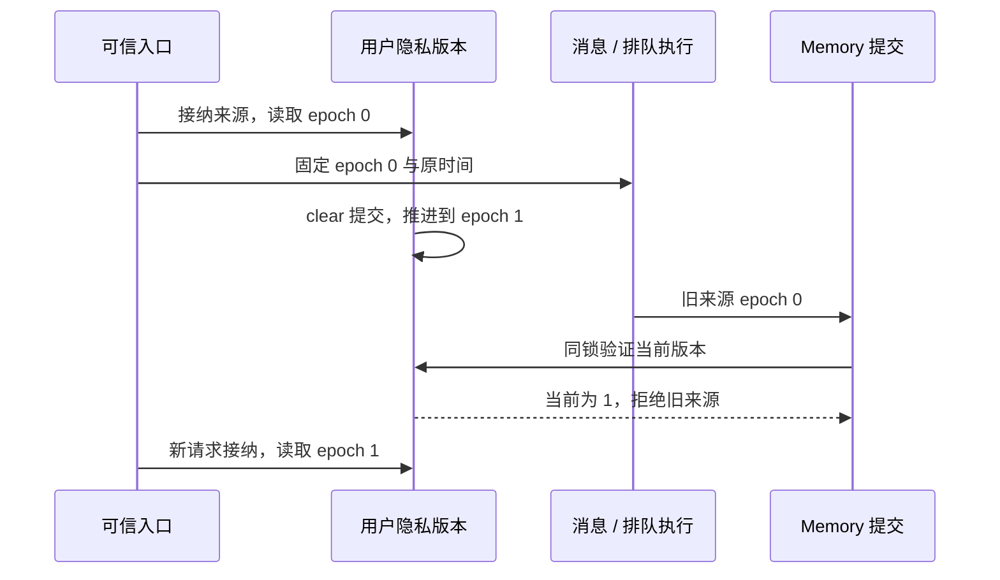

# 可信来源与隐私版本

更新：2026-09-14。本轮修复的因果边界；实际测试结果统一记录在 [构建记录](progress.md)。

Server 时间和 PostgreSQL 时间不一定同步。把 Server 的 `source_received_at` 与数据库删除时间比较，不能证明一项工作发生在 clear 之前或之后。原实现曾在工具分派时取得新的 Memory snapshot；Server 快 60 秒时，清除前排队的请求会被错误接纳并写回记忆。该场景保留为真实 PostgreSQL / Execution 回归，不能靠调整测试时间消除。

语音和文本输入在可信接纳时同时固定 `source_privacy_epoch` 与 `source_relationship_epoch`。`capture_source_epochs` 验证当前 active 用户，依次锁定账户、隐私、关系版本，在同一事务内读取两者；整个操作有 2 秒期限。成功提交是接纳的线性化点。此时尚未开始 STT、模型判断或应用排队，后续消费者只能保留原版本，不能重新接纳。

只需要 Memory 权限的系统/工具入口仍可通过 `capture_source_epoch` 读取同一接纳结果中的隐私版本；这不自动赋予 Appraisal 权限。原始输入时间继续作为审计数据，设备或模型不能指定版本。

## 各入口的接纳位置

| 入口 | 固定与继续验证 |
|---|---|
| CLI | 非空 Enter 后，数据库接纳成功才放入应用事件队列；保留 Enter 的原 Server 时间。尚未接纳的终端字节不等于已存在的可信来源。 |
| legacy 音频 RPC | 认证后、首次读取媒体前固定用户、epoch 和 adapter Arc；媒体读取完成后重新核对，不能给延迟上传换成新版本或另一 adapter。 |
| 持续 VoiceSession | Ready 之前固定会话输入版本，既有窗口和排队转写始终沿用；认证复查、续期和 Complete 前只比较。版本改变使旧会话关闭，新会话才能取得新版本。 |
| REST 工具 | 认证后、进入工具处理前取得版本。请求和重试不能在 worker 中再次接纳。 |
| 调度 / 规则 | 对已知 owner，在条件等待和内部动作排队之前固定版本，动作与 Execution 继续沿用。无 owner 的系统事件不会凭空取得用户 Memory 权限。 |

只持有 epoch 不意味着账户永远授权；入口与 Execution 仍分别验证当前账户、工具权限和绑定。版本是来源的一部分，不能从用户 JSON、模型参数、当前语音 scope 或后续 Memory snapshot 中补填。

## 持久化和提交

`chat_messages` 保存 nullable `source_privacy_epoch` 和 `source_relationship_epoch`，`execution_effects` 保存其原始隐私版本与 Context 来源。关系 stamp 在插入后不可修改，旧记录的 NULL 也不能补成当前版本。NULL 表示没有可信 stamp；它不表示版本 0 或当前版本。

来源消息保存原来的两个 epoch，即使排队后才落库、账户被停用或清除已发生，也不会换成新版本。原始消息写入验证 owner、会话、role 和 stamp 的结构；派生 Appraisal、Memory、Response 的接纳再检查当前授权，不能因为派生权限已撤销而伪造或丢弃此前接纳的原文。用户原文可以留在对话历史中；这不赋予它在 clear 后重新成为记忆来源的权限，也不意味着 clear 必须删除全部用户会话。

ToolContext → Execution 意图 → worker 原样传递该版本。epoch 和实际源消息 ID 参与幂等意图身份；重试保留首次接纳数据。MemoryStore / MemoryForget 先检查来源，再读取候选，最终在 guarded commit 的同一用户锁内重验。去重返回也需要有效来源，不能借“不必写入”绕过校验。

规范来源验证检查当前 epoch、每条源消息的 owner / role / 持久 epoch，以及源记忆 revision。单条工具来源还核对原消息的审计时间，使用 PostgreSQL 的微秒精度；这个比较用于同一来源的一致性，不用于跨机器判断 clear 的顺序。后台整理的多条消息各自以持久 epoch 为准，不能拿一次数据库观察时间筛选其他主机的输入时间。

对话抽取保留最初来源版本；提取前拒绝已经撤销的来源，模型晚返回时再次在提交中验证。投影仍需规范 revision / 状态验证，避免晚到向量复活。删除会推进保守的用户级版本，因此该用户其他旧来源工作也可能被拒；后续新接纳的输入获得新版本。

ContextLease 已将 Memory、图、缓存、历史和工具事实纳入输出与派生写入的接纳边界；本包进一步将 Appraisal/Relationship 与情感投影纳入同一根集合，具体约束见 [Appraisal 设计](appraisal-provenance-design.md)。清除关系只推进关系域；Memory 清除会删除依赖它的 Appraisal/投影并推进隐私域。数据库清除无法撤回设备已经呈现的内容，真实物理呈现与自然全双工验收仍需独立证据。
