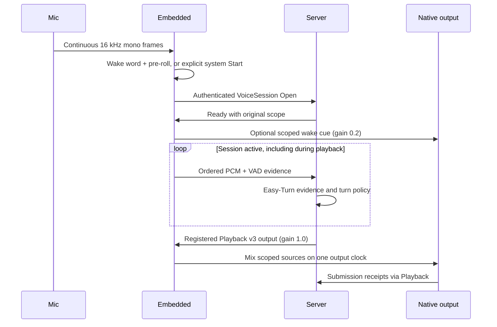

# Audio and Voice

The device voice path opens a continuous `VoiceSession` after a wake word or an
explicit authenticated system Start, selected by `speech.trigger`.
Embedded owns capture, VAD evidence, scoped native output, and short local cues.
The server owns turn decisions and recognized-input processing. Easy-Turn runs
on the server; enable its configured provider to admit production voice input.
Set `speech.channel_id` to the exact Server channel instance ID (the examples
use `pi-living-room`); the same value is required in Open and auth metadata.

## Voice Loop



The cue worker waits for an authenticated Ready and runs independently of
capture and network receive. Each wake admits at most one cue. It keeps the
original scope while loading the file; cancellation or a changed owner rejects
late work. Capture uses bounded `try_send`; overload ends the session rather
than dropping audio and preserving a false contiguous clock.

## Capture and Playback

CPAL and Linux ALSA backends support explicit device selection, fixed output
format, capture/playback volume, bounded buffers, and native timing evidence.
Capture sent to the server is mono 16 kHz; frames include sample offsets and VAD
activity. That configured target is distinct from the negotiated native input:
CPAL selects a supported configuration and ALSA negotiates nearby rates/channels
before software conversion. Playback sources are converted to the selected
fixed native format. Record both the requested values and actual startup/native
evidence; configuration alone does not prove a device's format or channel meaning.

For the Pi field setup, use explicit `audio.capture_backend = "alsa"` and
`audio.playback_backend = "alsa"` only with PCM names verified for the selected
devices. Match the named `CARD` and `DEV` to USB identity, serial or physical path
from enumeration; do not assume a numeric card index remains stable after
reconnect. `default` delegates selection to the host, and CPAL currently selects
the first device whose name contains the configured string. Neither proves that
the intended R1 input or speaker was selected. Keep the actual values in the
[central field record](../../../docs/operations/hardware-deployment-readiness.md)
rather than copying an unverified `hw:0,0` example.

`alsa_playback_lock_to_capture_rate` selects the configured capture rate at
startup for an explicitly confirmed shared-clock design; it does not establish
clock synchronization. Keep its default `false` for the proposed R1 USB capture
and separately selected output chain. USB connection does not prove that R1
offers playback or consumes USB audio as an AEC reference. Playback never retunes
the active capture clock.

The public R1 documentation separates processed mono UAC capture from an external
amplifier reference input; it does not establish USB playback or an internal USB
reference. The user's current R1 measurements establish UART_REAL 1.9.6 and
processed 16 kHz mono UAC; the C-Media output/reference connection is also confirmed.
Exact reference electrical limits and acoustic AEC performance remain separate
from this host integration. Follow the [current R1 field record](../../../docs/operations/hardware-deployment-readiness.md#r1-主机侧接入2026-10-21),
including the user's correction that directional suppression is normal.
The current capture converter averages every negotiated native input channel before
conversion. Setting `capture_channels = 1` does not select a processed channel.
A confirmed processed mono endpoint can use this path; an endpoint combining
processed, raw or reference signals needs a verified channel selection first.
Hardware AEC does not automatically require a second host AEC processor or reader.

Normal Embedded startup opens native playback and capture before the wake word;
Linux ALSA availability checks can also open PCM handles. Use the
[read-only configuration check](configuration.md#config-path) and the separate
staging profile during preparation. Do not start the native runtime or query its
audio health as a way to avoid opening the devices.

Native playback has exactly two sources: conversation **1.0** and local cue
**0.2**. The sum is clamped to PCM range. Both retain the original session/control
and native generation. A cue does not consume remote playback sequence numbers
or acquire a replacement output owner. There is no configurable mixer slot.

## R1 System-Controlled Capture

The separate [`embedded.r1-system.example.toml`](../../../config/embedded.r1-system.example.toml)
selects `speech.trigger = "system"` and `modules.wakeword = "noop"`. Native
capture stays open locally, but PCM is not uploaded until the bound controller
calls `alia.capture.v1.CaptureControl.Start`. A manual-wake ACK is never a
WakeWord event or a new bearing. System Start does not play a wake cue or send
UART commands. The natural-wake preset continues to use the existing R1 owner.

After an **operator-confirmed real R1 power cycle**, use a new non-nil UUID for
that physical cold boot and run:

```sh
alia-embedded --initialize-r1 /absolute/private/embedded.toml <cold-boot-uuid>
```

This is a runtime startup command, not an initialization process that exits.
It first claims the cold boot and opens the control UART, including clearing
stale input, before starting native ALSA capture. After checking an actual
16 kHz mono frame without resampling, it runs the bounded initialization on
that same UART descriptor without reopening or clearing it. This preserves a
handshake arriving during capture startup and follows the validated cold-03
order. The capture stream remains open throughout initialization and the runtime. The current firmware must match the exact validated UART_REAL
1.9.6 build. There is one `manual_wakeup` with fixed **directional beam 0**;
this is neither omnidirectional pickup nor natural direction detection. The
control UART closes when initialization finishes, while the capture stream
continues. Normal startup, reconnect and session reset never send this command.

Before opening the UART, initialization durably creates
`<state_path>.r1-initialization/<cold-boot-uuid>.jsonl`. An existing claim, even
empty, failed or incomplete, blocks a second attempt. A matching numeric
`code:0` ACK appends `command_accepted`; this does not prove speech quality.
ACK timeout, partial write, cancellation or later startup failure may leave
the board initialized with an unknown result. Do not delete claims, change the
state path or invent a new UUID to retry the same boot. A new UUID is permitted
only after another confirmed physical cold boot. Back up this directory with
the device state. The program records the operator's cold-boot declaration;
it does not measure board power.

For an ordinary process restart on the still-powered board, use the same
private configuration through `ALIA_EMBEDDED_CONFIG_PATH` with no initialization
arguments. This does not reinitialize the board or prove that its prior state
survived. Unexpected board restart, USB loss or silence requires diagnosis and
explicit recovery; there is no periodic wake or automatic cold-boot detection.
Use the current USB identities and confirmed physical beam-0 position from the
[field record](../../../docs/architecture/r1-system-controlled-capture-research-2026-10-23.md#71-2026-10-24独立冷启动-cold-03-实测),
and verify the selected UART and PCM belong to the intended device.

The controller first calls authenticated `Inspect`, then sends its returned
`device_boot_id` and `generation` as `expected_generation` to Start or Stop.
Commands use the existing `embedded:control` binding credentials. `active=true`
means local admission; the original VoiceSession still must authenticate and
receive Server Ready. Stop targets that exact generation, closes upload,
joins its network/cue tasks, and waits for native output retirement. It does
not power down the microphone or establish physical speaker silence. Stale
commands cannot affect a replacement session; after an uncertain RPC outcome,
inspect state instead of blindly replaying a command with a new generation.
Failures return to idle without automatic Start. System Start discards the already-published PCM queue and pre-roll and never
synthesizes wake metadata. A native block already in flight can include samples
captured before admission; this is a session boundary, not an acoustic shutter.

The independent cold-03 experiment established one cold boot, 395.56 seconds
of continuous saved PCM and intelligible speech after 300.02 seconds of silence
on the current device/firmware/beam/position. One 20 ms auxiliary reference copy
was missing; saved PCM continuity was intact. These results are not production
dialogue, all-day operation, another direction, AEC or a real-model acceptance.
The new runtime/RPC path needs its own field acceptance before those claims.

## Local VAD and Cues

Sherpa handles local wake words; R1 can supply its own wake events. The `silero`
VAD runs the existing ONNX model through Rust `ort` bindings, sharing the bundled
ONNX Runtime with Sherpa. It retains only a fixed input window and recurrent
state, rather than an entire speech segment. Strong speech starts activity;
weaker speech above the hysteresis threshold can sustain it without a duration
cutoff or periodic model reset. VAD labels activity but never closes a turn,
runs a local transcript, or matches a spoken stop phrase. An optional
`wakeword` action (or the triggering wake keyword) resolves the current cue.
Metadata lives in SQLite and WAV assets stay on disk. Cue records require a
nonempty audio path with finite positive weight; action-only records and built-in
spoken cancel aliases are rejected. Missing cues leave capture running. The
[current wake cue example](../../../config/direct_response.example/README.md)
reuses an existing short repository sample. The decoder accepts bounded PCM16 WAV, averages multichannel input to
mono, and rejects empty/invalid input, clips longer than five seconds, or files
larger than 4 MiB.

The old thinking timer, follow-up window, transcript-based local cancel, and
server-requested fallback/direct-response trigger have been removed. New prompt
uses must be admitted through the same scoped cue path instead of raw playback.

## Pause, Cancellation, and Session Closure

The server distinguishes temporary yielding from explicit pause through the
existing Hold/Resume contract. A voice-evidence decision alone is not an applied
pause receipt. Independent Playback control establishes the actual owner-bound
software Hold. Cues are ephemeral: Hold suppresses the remaining cue tail, so it
is not replayed after conversation resumes. Retirement cancels both sources.

Network failure, capture discontinuity, queue overflow, binding change, invalid
session evidence, or runtime shutdown cancels and joins the network and cue
workers and retires the capture scope. A new connection needs a fresh wake or,
in system mode, a new explicit Start.
There is no separate wakeword interrupt RPC or local follow-up endpointing path.

`CaptureControl.Stop` provides explicit authenticated input-session closure.
A spoken "end conversation" tool is not yet wired to this low-level operation.
The deleted `end_continuous_dialogue` tool is not mapped to Playback Fence,
which controls output admission and does not stop microphone upload by itself.

## Debugging and Limits

The old source-WAV recorder and `[audio_debug]` configuration have been removed.
It recorded a local cue before mixing/native acceptance and did not establish
dual-stream timing evidence. Remove that obsolete table from local configuration;
file loading and settings updates reject it even when disabled.

R02-A records bounded native input and final output evidence through one exclusive
consumer. Its explicit session and offline replay do not start audio devices,
record automatically, or add AEC. Capture is the data delivered by the backend,
which may already have been processed by device firmware. It is not proof of raw
ADC samples or acoustic capture/playback alignment. Missing reference stays
missing; recorded zero-valued samples are separate evidence.

The `audio_evidence_replay` example has two explicit operations. From the
repository root, choose a new output path whose parent already exists:

```sh
cargo run -p alia-embedded --no-default-features --example audio_evidence_replay --offline --locked -- generate /tmp/alia-synthetic-evidence.json
cargo run -p alia-embedded --no-default-features --example audio_evidence_replay --offline --locked -- replay /tmp/alia-synthetic-evidence.json
```

`generate` publishes the bounded `SyntheticFixture` without overwriting and
reads it back. `replay` only reads an existing ordinary evidence JSON file;
it does not create files or play audio. The old implicit one-path invocation
is rejected, as are missing/extra arguments. `--help` only prints usage.
Input symlinks and special files are rejected; imports retain the library's
16 MiB cap and schema checks. Local parent directories remain operator-owned;
synchronous file operations do not have a wall-clock timeout. Returned errors
clean up unpublished temporary output; process kill or power loss may leave
a temporary file, and a published file is not rolled back if later reading fails.

The JSON summary derives per-stream record/frame/sample counts, reset reasons,
observed close markers and matching latest snapshots from the input. Empty,
single-direction and snapshot-only evidence are supported. A replaced stream
without its own observed close marker or matching closed snapshot has unknown
final state. Active snapshot fields are independent observations; a missing
queue entry is never reconstructed as silence or called a lost PCM block solely
from a sequence difference. The source tag is an unauthenticated declaration,
including `ObservedNative`. No report certifies physical completeness or alignment.
Closed snapshots must leave enough successful attempts and frames to account
for the records actually present; contradictory loss totals are rejected.

Timing belongs to each native stream. A native batch is observed once before
being split into reference blocks; split sample timestamps use nominal-rate
offsets, not independent device measurements. A backward callback or sample
anchor marks a new continuity segment and makes that entire batch's reading
unknown without deleting its PCM or rewinding its frame cursor.

Replay also reports `ClockDiscontinuity` when adjacent PCM in the same stream
changes clock quality or callback/sample timestamp availability, or either
timestamp moves backwards. Marker records are not clock measurements. This
preserves old evidence and its original samples; it tells consumers to discard
stale timing assumptions, not that a physical clock failure or PCM gap was proven.
Equal callback timestamps, negative sample origins, and changing queue-delay or
host-observation values alone do not establish clock discontinuity or drift.

There is no selected AEC consumer. Reference blocks, speech transport blocks,
VAD windows and resampler chunks have separate sizes and purposes. Claiming the
reference reader does not insert AEC into the converted speech path. Alignment,
drift estimation and algorithm framing require confirmed consumer and device
contracts; see the [clock and consumer contract](../../../docs/refactor/audio-reference-clock-design.md#r02-时钟缺口与-consumer-契约2026-10-14).

The Mac offline combination tests also send generated PCM through the production
capture helper, final voice/cue mixer callback and one `EvidenceSession`, then
export, import and replay it. They cover exact cue cancellation, explicit
hold/resume, observation cancellation/drop, overflow, a lost close marker and
stream reopening. They open no native stream; their assertions cover software
samples, ownership and cleanup, not wall-clock or acoustic latency.

An explicit library caller still owns any real `EvidenceSession`, its bounded
pumping, finish/cancellation and export; no default recorder or runtime daemon
is enabled. The 512-record / 16 MiB limits bound software retention, not a
guaranteed number of seconds. Agree real-audio destination, retention and deletion
before authorized recording. Always inspect termination, discarded records and
footer information; an ended observation is not a complete physical stream.

Native submission receipts and exported software evidence do not prove physical
presentation, silence, echo cancellation, or full-duplex acoustic quality.
Hardware AEC and device measurement still require field validation. Existing
server shadow/default policies are unchanged.
