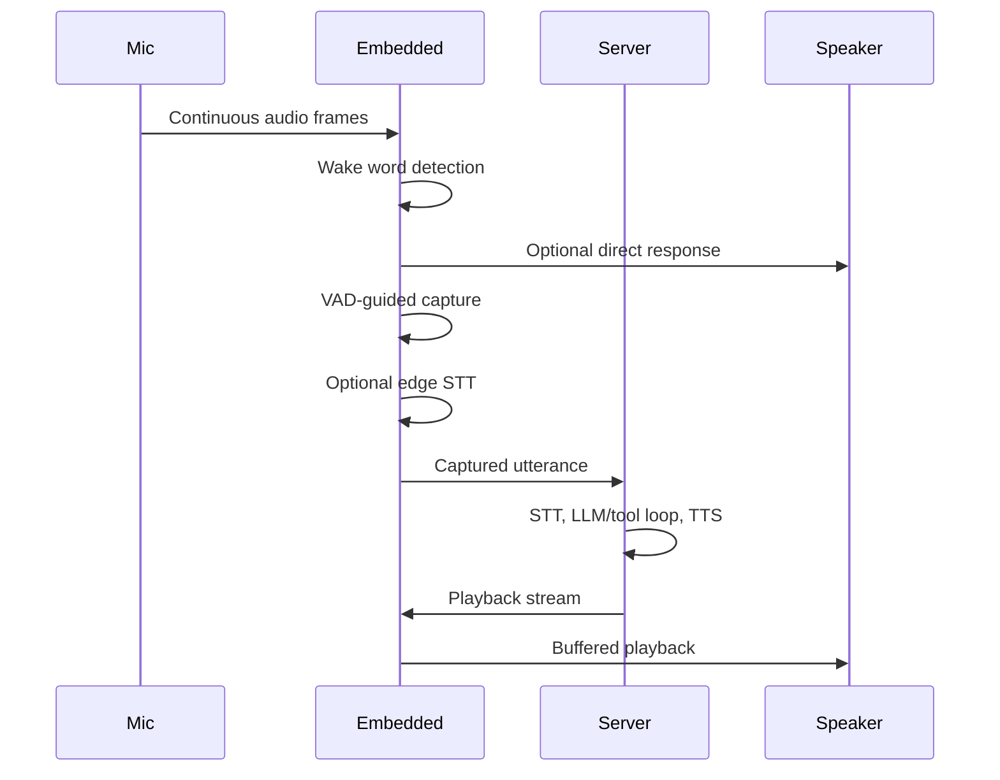

# Audio and Voice

The embedded voice path is optimized for responsiveness. Wake word detection,
direct responses, VAD endpointing, and playback interruption happen locally.

## Voice Loop

## Capture and Playback

The audio layer supports CPAL and a Linux ALSA fallback path. On Raspberry Pi
audio HATs, capture/playback device behavior may be board-specific. Useful
settings include:

- capture device/backend selection
- playback device/backend selection
- sample-rate behavior
- ALSA S32 alignment detection
- capture and playback volume
- playback buffer sizing
- debug WAV recording

## Wake Word and VAD

sherpa-onnx handles local wake word detection and VAD. VAD controls when
post-wake capture starts and ends so the system does not cut users off after a
short pause.

## Direct Responses

Direct responses are local feedback, not assistant answers. Supported response
classes include:

- wake word acknowledgement
- cancel or stand-down response
- fallback when server communication fails
- listening start prompt
- listening continue prompt

All response classes are optional. Missing files should log an error or warning
and continue the voice flow.

Direct response assets stay on disk. Metadata is imported into SQLite from
`config.json` bundles under the direct response directory. After successful
import, the bundle config is removed so repeated boots do not re-import it.

## Interruption

When wake word is detected during playback, embedded should:

1. stop local playback immediately
2. send an active-turn interrupt to the server
3. skip the normal wake word direct response by default
4. start a fresh capture window

This makes barge-in feel natural and avoids speaking over the user.

## Continuous Dialogue

After a successful wake word turn, embedded can keep a bounded follow-up
listening state active. Users can continue speaking without repeating the wake
word until the follow-up timeout or turn limit is reached.

## Audio Debugging

Enable audio debug WAV capture only while diagnosing problems. The files can
grow quickly, but they are valuable for verifying:

- raw microphone capture
- wake word segments
- post-wake capture
- playback payloads
- sample-rate or channel conversion issues

