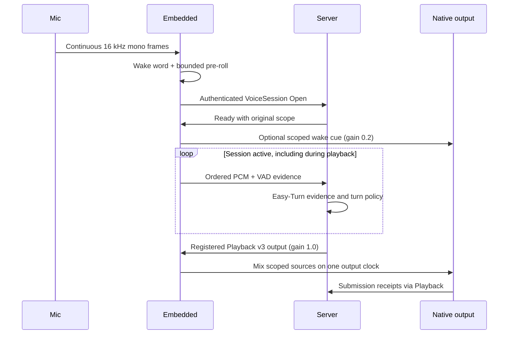

# Audio and Voice

The only device voice path opens a continuous `VoiceSession` after wake word.
Embedded owns capture, VAD evidence, scoped native output, and short local cues.
The server owns turn decisions and recognized-input processing. Easy-Turn runs
on the server; enable its configured provider to admit production voice input.
Set `speech.channel_id` to the exact Server channel instance ID (the examples
use `pi-living-room`); the same value is required in Open and auth metadata.

## Voice Loop

The cue worker waits for an authenticated Ready and runs independently of
capture and network receive. Each wake admits at most one cue. It keeps the
original scope while loading the file; cancellation or a changed owner rejects
late work. Capture uses bounded `try_send`; overload ends the session rather
than dropping audio and preserving a false contiguous clock.

## Capture and Playback

CPAL and Linux ALSA backends support explicit device selection, fixed output
format, capture/playback volume, bounded buffers, and native timing evidence.
Capture sent to the server is mono 16 kHz; frames include sample offsets and VAD
activity. Playback sources are converted to the selected fixed native format.
On shared Pi I2S clocks, the configured playback rate can follow capture at
startup. Playback never retunes the active capture clock.

Native playback has exactly two sources: conversation **1.0** and local cue
**0.2**. The sum is clamped to PCM range. Both retain the original session/control
and native generation. A cue does not consume remote playback sequence numbers
or acquire a replacement output owner. There is no configurable mixer slot.

## Local VAD and Cues

sherpa-onnx handles wake word and VAD. VAD labels activity but never closes a
turn, runs a local transcript, or matches a spoken stop phrase. An optional
`wakeword` action (or the triggering wake keyword) resolves the current cue.
Metadata lives in SQLite and WAV assets stay on disk. Cue records require a
nonempty audio path with finite positive weight; action-only records and built-in
spoken cancel aliases are rejected. Missing cues leave capture running. The
[current wake cue example](../../../config/direct_response.example/README.md)
reuses an existing short repository sample. The decoder accepts bounded PCM16 WAV, averages multichannel input to
mono, and rejects empty/invalid input, clips longer than five seconds, or files
larger than 4 MiB.

The old thinking timer, follow-up window, transcript-based local cancel, and
server-requested fallback/direct-response trigger have been removed. New prompt
uses must be admitted through the same scoped cue path instead of raw playback.

## Pause, Cancellation, and Session Closure

The server distinguishes temporary yielding from explicit pause through the
existing Hold/Resume contract. A voice-evidence decision alone is not an applied
pause receipt. Independent Playback control establishes the actual owner-bound
software Hold. Cues are ephemeral: Hold suppresses the remaining cue tail, so it
is not replayed after conversation resumes. Retirement cancels both sources.

Network failure, capture discontinuity, queue overflow, binding change, invalid
session evidence, or runtime shutdown cancels and joins the network and cue
workers and retires the capture scope. A new connection needs a fresh wake.
There is no separate wakeword interrupt RPC or local follow-up endpointing path.

A future explicit **input-session close** command remains required for a spoken
"end conversation" tool. It must acknowledge authenticated capture closure.
The deleted `end_continuous_dialogue` tool is not mapped to Playback Fence,
which controls output admission and does not stop microphone upload by itself.

## Debugging and Limits

Optional debug WAVs record selected capture and playback payloads. They may grow
quickly, so enable them only for a bounded diagnostic run. Native submission
receipts and local WAV files do not prove physical presentation, silence,
echo cancellation, or full-duplex acoustic quality. Hardware AEC and device
measurement remain deferred. Existing server shadow/default policies are
unchanged by this voice-path cleanup.
