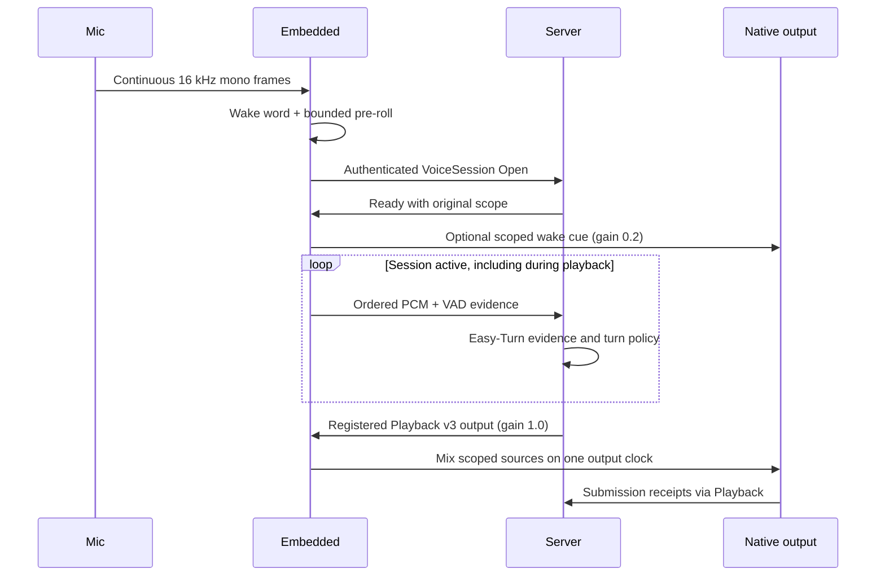

# Audio and Voice

The only device voice path opens a continuous `VoiceSession` after wake word.
Embedded owns capture, VAD evidence, scoped native output, and short local cues.
The server owns turn decisions and recognized-input processing. Easy-Turn runs
on the server; enable its configured provider to admit production voice input.
Set `speech.channel_id` to the exact Server channel instance ID (the examples
use `pi-living-room`); the same value is required in Open and auth metadata.

## Voice Loop

The cue worker waits for an authenticated Ready and runs independently of
capture and network receive. Each wake admits at most one cue. It keeps the
original scope while loading the file; cancellation or a changed owner rejects
late work. Capture uses bounded `try_send`; overload ends the session rather
than dropping audio and preserving a false contiguous clock.

## Capture and Playback

CPAL and Linux ALSA backends support explicit device selection, fixed output
format, capture/playback volume, bounded buffers, and native timing evidence.
Capture sent to the server is mono 16 kHz; frames include sample offsets and VAD
activity. That configured target is distinct from the negotiated native input:
CPAL selects a supported configuration and ALSA negotiates nearby rates/channels
before software conversion. Playback sources are converted to the selected
fixed native format. Record both the requested values and actual startup/native
evidence; configuration alone does not prove a device's format or channel meaning.

For the Pi field setup, use explicit `audio.capture_backend = "alsa"` and
`audio.playback_backend = "alsa"` only with PCM names verified for the selected
devices. Match the named `CARD` and `DEV` to USB identity, serial or physical path
from enumeration; do not assume a numeric card index remains stable after
reconnect. `default` delegates selection to the host, and CPAL currently selects
the first device whose name contains the configured string. Neither proves that
the intended R1 input or speaker was selected. Keep the actual values in the
[central field record](../../../docs/operations/hardware-deployment-readiness.md)
rather than copying an unverified `hw:0,0` example.

`alsa_playback_lock_to_capture_rate` selects the configured capture rate at
startup for an explicitly confirmed shared-clock design; it does not establish
clock synchronization. Keep its default `false` for the proposed R1 USB capture
and separately selected output chain. USB connection does not prove that R1
offers playback or consumes USB audio as an AEC reference. Playback never retunes
the active capture clock. The R1 reference route and electrical compatibility
remain in the central field record until confirmed.

Normal Embedded startup opens native playback and capture before the wake word;
Linux ALSA availability checks can also open PCM handles. Use the
[read-only configuration check](configuration.md#config-path) and the separate
staging profile during preparation. Do not start the native runtime or query its
audio health as a way to avoid opening the devices.

Native playback has exactly two sources: conversation **1.0** and local cue
**0.2**. The sum is clamped to PCM range. Both retain the original session/control
and native generation. A cue does not consume remote playback sequence numbers
or acquire a replacement output owner. There is no configurable mixer slot.

## Local VAD and Cues

sherpa-onnx handles wake word and VAD. VAD labels activity but never closes a
turn, runs a local transcript, or matches a spoken stop phrase. An optional
`wakeword` action (or the triggering wake keyword) resolves the current cue.
Metadata lives in SQLite and WAV assets stay on disk. Cue records require a
nonempty audio path with finite positive weight; action-only records and built-in
spoken cancel aliases are rejected. Missing cues leave capture running. The
[current wake cue example](../../../config/direct_response.example/README.md)
reuses an existing short repository sample. The decoder accepts bounded PCM16 WAV, averages multichannel input to
mono, and rejects empty/invalid input, clips longer than five seconds, or files
larger than 4 MiB.

The old thinking timer, follow-up window, transcript-based local cancel, and
server-requested fallback/direct-response trigger have been removed. New prompt
uses must be admitted through the same scoped cue path instead of raw playback.

## Pause, Cancellation, and Session Closure

The server distinguishes temporary yielding from explicit pause through the
existing Hold/Resume contract. A voice-evidence decision alone is not an applied
pause receipt. Independent Playback control establishes the actual owner-bound
software Hold. Cues are ephemeral: Hold suppresses the remaining cue tail, so it
is not replayed after conversation resumes. Retirement cancels both sources.

Network failure, capture discontinuity, queue overflow, binding change, invalid
session evidence, or runtime shutdown cancels and joins the network and cue
workers and retires the capture scope. A new connection needs a fresh wake.
There is no separate wakeword interrupt RPC or local follow-up endpointing path.

A future explicit **input-session close** command remains required for a spoken
"end conversation" tool. It must acknowledge authenticated capture closure.
The deleted `end_continuous_dialogue` tool is not mapped to Playback Fence,
which controls output admission and does not stop microphone upload by itself.

## Debugging and Limits

The old source-WAV recorder and `[audio_debug]` configuration have been removed.
It recorded a local cue before mixing/native acceptance and did not establish
dual-stream timing evidence. Remove that obsolete table from local configuration;
file loading and settings updates reject it even when disabled.

R02-A records bounded native input and final output evidence through one exclusive
consumer. Its explicit session and offline replay do not start audio devices,
record automatically, or add AEC. Capture is the data delivered by the backend,
which may already have been processed by device firmware. It is not proof of raw
ADC samples or acoustic capture/playback alignment. Missing reference stays
missing; recorded zero-valued samples are separate evidence.

The existing `audio_evidence_replay` example generates a `SyntheticFixture`,
publishes it to a new caller-chosen path and reads it back. It does not collect
live microphone data or accept an existing recording as its CLI input. An
explicit library caller owns any real `EvidenceSession`, its bounded pumping,
finish/cancellation and export; no default recorder or runtime daemon is enabled.
The 512-record / 16 MiB limits bound software retention, not a guaranteed number
of seconds. Agree the real-audio destination, retention and deletion procedure
in the central field record before an authorized recording. Exported footer and
loss information remain necessary; an ended observation is not a complete
physical stream or synchronized capture/playback measurement.

Native submission receipts and exported software evidence do not prove physical
presentation, silence, echo cancellation, or full-duplex acoustic quality.
Hardware AEC and device measurement still require field validation. Existing
server shadow/default policies are unchanged.
