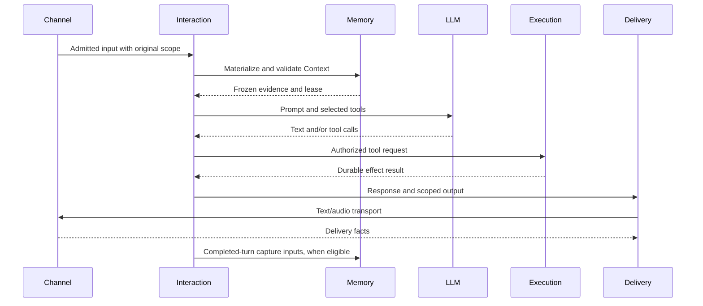

# Server Architecture

`alia-server` is a Rust modular monolith. Bootstrap assembles the process;
Interaction owns conversation use cases; Memory owns canonical memories and
their provenance; Execution owns durable tool effects; Delivery owns response
and presentation facts. Channels carry authenticated I/O between these services
and CLI or embedded endpoints.

## Current Ownership

| Path under `src/` | Responsibility |
| --- | --- |
| `bootstrap/` | Build and initialize the service graph, select concrete provider adapters, bind listeners, construct the aggregate `ModuleRegistry`, and retain runtime shutdown ownership. |
| `modules/platform/` | Lifecycle, owned background tasks, identity checks, and migrations. |
| `modules/interaction/` | Bounded input supervision, turn state and cancellation, context assembly, routing, generation/tool loops, streaming, expression coordination, and response persistence. |
| `modules/memory/` | Concrete `MemoryService`, memory types and policy, source/privacy transitions, retrieval and embedding projections, Context leases, and completed-turn capture. |
| `modules/companion/` | Companion observations, appraisal and relationship processing, initiative candidates, and Shadow/live admission policy. |
| `modules/execution/` | Tool authorization, durable effect records, dispatch, and recovery. |
| `modules/delivery/` | Canonical Response/Delivery records, scoped output control, delivery receipts, and owned output producers. |
| `channels/` | Multi-instance transport adapters, the channel registry, channel events, and text/audio/device transport contracts. |
| `providers/`, `adapters/` | Model/provider implementations; `adapters/easy_turn` supplies turn evidence. Some fixed core services remain under `providers/`, listed below. |
| `api/`, `grpc/`, `ws/` | HTTP, gRPC, and WebSocket admission, authentication, and request translation. |
| `entity/` | SeaORM persistence mappings. PostgreSQL remains the server store. |

The retired `channels/pipeline`, `providers/memory`, and `module` paths have no
compatibility facade. Callers use the owning modules directly.

## Interaction And Memory

`spawn_interaction` owns a bounded input supervisor. It dispatches admitted work
to turn, context, generation, streaming, and persistence code in Interaction.
Transport code no longer owns these use cases. Bootstrap supplies an explicit
`InteractionServices` dependency set; it does not hand Interaction the aggregate
runtime registry, scheduler, STT service, or process cleanup owner.

Memory is a fixed core service. It is created directly as `MemoryService` and is
not selected through a provider slot or replaced by a no-op memory backend.
Recall and capture policy control model use; disabling recall does not remove
storage, erasure, or privacy controls. Memory contracts live in
`modules/memory`, including the immutable `CaptureTurn` inputs passed by
Interaction after an assistant response is committed. Memory owns extraction,
candidate filtering, source validation, and the authorized write transaction.

The diagram omits optional cache reuse and repeated LLM/tool steps. Generation
does not establish delivery completion. Context revocation, source epochs,
explicit pause, temporary yield, and effect receipts retain their separate
contracts. Trace records remain separate from conversation messages.

## Provider Selection

`[modules]` selects STT/TTS adapters. LLM and embedding roles in `[llm.roles]`
refer to named `[profiles.llm.*]` entries. Bootstrap selects concrete
implementations; domain services consume the relevant contracts. Easy-Turn is
constructed by Bootstrap and runs on the server; its evidence does not bypass
Interaction policy.

| Configuration | Typical implementation | Purpose |
| --- | --- | --- |
| `llm.roles.minor` | `profiles.llm.minor` | Routing, tool narrowing, and simpler generation. |
| `llm.roles.major` | `profiles.llm.major` | More complex generation. |
| `modules.stt` | `whisper_cpp` | Server speech recognition. |
| `modules.tts` | `gpt_sovits` | Speech synthesis. |
| `llm.roles.embedding` | `profiles.llm.embedding` | Semantic retrieval and cache projections. |

Tools, skills, settings, sensors, conditions, and actions extend fixed
registries. Plugins register owned capabilities; they do not replace the
registries themselves.

## Lifecycle And Failure Ownership

Bootstrap registers cleanup before initialization can fail. Platform lifecycle
code retains the cleanup owner across cancelled waiters and shutdown deadlines.
Shutdown closes admission, drains producers and Execution, then releases
Delivery, channels, downstream resources, and the database in dependency order.
An unproven native or panicked stop must not be reported as completed.

Runtime provider failures affect the current path; error handling does not
invent delivery evidence or switch canonical Memory storage to a fallback.
Configured startup capability and identity errors remain explicit failures.

## Remaining Architecture Work

This migration completes Memory and Interaction ownership plus the old assembly
directory cleanup. It does not complete every boundary in the proposal:

- Fixed conversation, cache, persona, router, skills, insights, and sensor
  implementations still live under `providers/`. Their eventual relocation
  must preserve existing policies and lifecycle semantics.
- `providers/adapter.rs` still groups non-Memory contracts from several domains.
  `ModuleContext` remains a broad initialization dependency bundle, while
  runtime Interaction receives the narrower service set.
- Context, Companion, and Delivery retain existing cross-domain transactional
  validation. Moving their tables or transaction coordination requires a
  separate ownership review; a directory move does not prove isolation.
- Delivery still uses channel transport contracts and the existing TTS audio
  budget. This round does not redesign that budget or the transport ports.

The bounded migration check is `python3 scripts/check-server-boundaries.py` from
the repository root; `--self-test` checks the guard's rejection cases. It checks
retired paths/contracts and selected dependency directions, not full semantic
correctness. Test results and current outstanding work belong in the
[2026-10-08 checklist](../../../docs/refactor/checklists/layering-2026-10-08.md).
