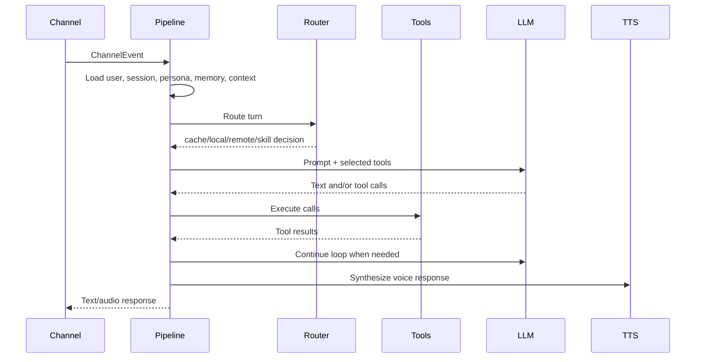

# Server Architecture

`alia-server` is the coordinator. It receives channel events, routes turns
through the AI pipeline, calls model providers and tools, persists state, and
exposes APIs for the frontend and future plugins.

## Main Layers

| Layer | Responsibility |
| --- | --- |
| API | Axum routes under `/api/v1`, `/health`, OpenAPI/Scalar, OOBE/bootstrap, settings, devices, users, auth, sensors, rules, scheduler, tools, skills, and conversations. |
| Channels | Multi-instance I/O adapters such as embedded gRPC and CLI. Channels translate user/device I/O into pipeline events and deliver responses. |
| Pipeline | Turn orchestration: conversation context, routing, cache, memory snippets, skills, tools, LLM/tool loop, TTS, delivery, persistence, and agent trace events. |
| Providers | Swappable adapters for LLM, STT, TTS, embeddings, memory, cache, skills, persona, routing, rules, scheduler, insights, and tools. |
| Registries | Runtime access to modules, channels, settings, tools, skills, dependency ownership, scheduler conditions/actions, and sensors. |
| Persistence | PostgreSQL via SeaORM for users, sessions, messages, agent events, tools, skills, cache, personas, rules, scheduler tasks, settings, and sensor data. |

## Module Slots

The `[modules]` section in `config/server.toml` selects implementations. Provider
files configure those implementations.

| Slot | Typical implementation | Purpose |
| --- | --- | --- |
| `llm` | `openai` | Default LLM adapter. |
| `local_llm` | `ollama` | Lightweight/local model for routing and simple work. |
| `remote_llm` | `openai` | Larger model for complex turns. |
| `stt` | `whisper_cpp` | Server-side speech recognition. |
| `tts` | `gpt_sovits` | Server-side speech synthesis. |
| `embedding` | `ollama` or `openai` | Embeddings for semantic cache and retrieval. |
| `memory` | `mem0` or `simple` | User memory backend. |
| `cache` | `db` | PostgreSQL exact and semantic response cache. |
| `skills` | `builtin` | Skill registry and intent matching. |
| `persona` | `template` | Persona prompt rendering. |
| `insights` | `scheduled` or `noop` | Background analysis and cache review hooks. |
| `router` | `multi_layer` | Cache/local/remote/skill routing decision. |
| `rule_engine` | `automation` | Event-driven automation rules. |
| `scheduler` | `automation` | Cron, one-shot, interval, condition polling, and event subscriptions. |
| `tools` | `builtin` | Tool registry and code-backed execution. |

## Pipeline Flow

The pipeline records traceable agent events separately from chat messages so a
frontend can inspect route decisions, tool calls, tool results, cache behavior,
and delivery steps.

## Failure Model

Startup failures should disable only the affected module or channel when
possible. Runtime turn failures are logged and should not disable a channel by
default. Provider failures should degrade the specific path, not panic the whole
process.

## Plugin Direction

Future plugins should use the same registries as built-ins:

- register tools, skills, settings, sensors, conditions, and actions
- register dependency ownership for safe uninstall
- expose health and restart requirements
- avoid private side registries that the frontend, scheduler, or tools cannot see
