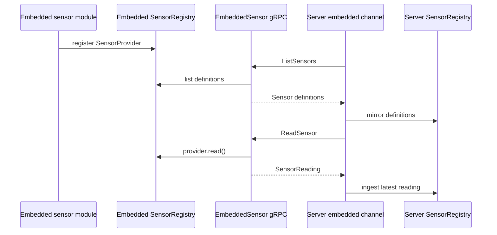

# Channels and Sensors

Channels are multi-instance I/O adapters. They do not own assistant reasoning;
they convert external events into pipeline events and deliver responses back to
the external system.

## Channel Capabilities

Each channel declares capabilities such as:

- text input/output
- voice input/output
- streaming response support
- streaming audio playback support
- sensors
- hardware control
- presence

This keeps behavior channel-local. The embedded channel can support voice
interruption and hardware actions without forcing the same semantics onto CLI or
future chat integrations.

## Embedded Channel

The embedded channel talks to `alia-embedded` over gRPC. It currently handles:

- captured audio upload through the server audio ingress service
- TTS playback streaming to the device
- playback stop and active-turn interruption
- settings and direct response management
- volume control
- plugin management
- sensor discovery, reads, and sensor-specific commands

## Sensor Registry

The server has one shared `SensorRegistry`. It is visible to:

- REST API under `/api/v1/sensors`
- built-in `sensor_read` and `sensor_list` tools
- scheduler/rules condition evaluators
- insights and future plugins
- frontend inspection

The registry stores sensor definitions and latest/time-series readings. It also
tracks source ownership for dependency checks.

## Embedded Sensor Mirroring

Embedded owns concrete sensor code. Server owns the unified registry view.



Public server-side sensor ids use the channel namespace:

```text
{channel_id}:{embedded_sensor_id}
```

For example, embedded sensor `temperature` on channel `pi5` becomes
`pi5:temperature` in the server registry. The registry source is
`component:{channel_id}`.

The embedded channel reconciles sensors:

- on successful gRPC connection
- when `list_embedded_sensors` is called
- periodically while connected

Sensors that disappear from embedded discovery are marked offline by clearing
`last_seen_at`. They are not deleted automatically, so existing rules,
scheduler tasks, and frontend references do not break.

## Channel Sensor Actions

Embedded channel actions include:

| Action | Purpose |
| --- | --- |
| `list_embedded_sensors` | List embedded sensors and mirror definitions into the server registry. |
| `read_embedded_sensor` | Read a concrete embedded sensor and ingest the reading into the server registry. |
| `invoke_embedded_sensor` | Run a sensor-specific command exposed by the embedded provider. |

`read_embedded_sensor` accepts either the public id (`pi5:temperature`) or the
embedded-local id (`temperature`). The channel strips its own prefix before
calling embedded.
